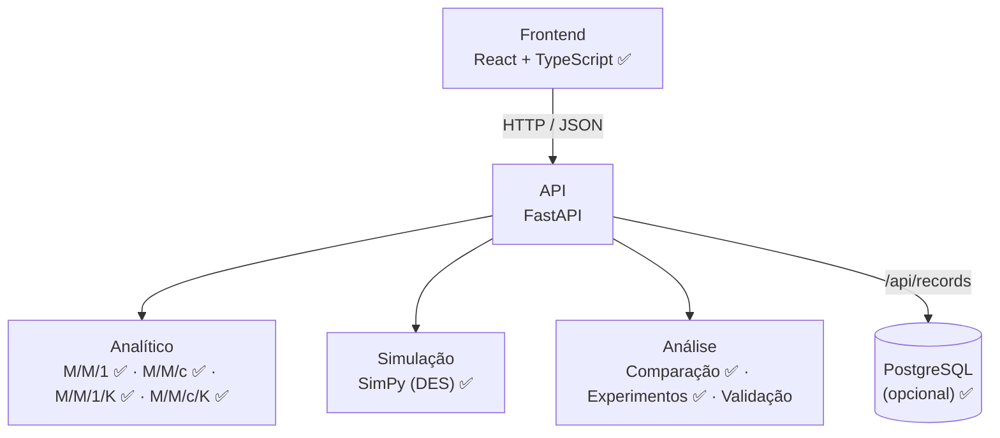

# QSimulador

> Laboratório interativo de modelagem, simulação e análise de sistemas de filas.


-blue)

O **QSimulador** é uma ferramenta educacional e experimental para modelar, simular e analisar sistemas computacionais que apresentam comportamento de filas (servidores web, APIs, bancos de dados, serviços distribuídos).

Mais do que uma calculadora de teoria das filas, a proposta é uma **plataforma experimental** que integra, em um único fluxo, modelagem analítica, simulação de eventos discretos e análise de resultados.

## Status

O projeto está em desenvolvimento. Os modelos **M/M/1**, **M/M/c**, **M/M/1/K** e **M/M/c/K** (cálculo analítico, simulação e comparação) e a API já funcionam; a interface web também já está disponível; os experimentos (varredura de parâmetros, comparação de servidores e análise de sensibilidade) também já estão disponíveis; a validação com dados reais (análise do CSV do JMeter com recomendação do modelo, CSV agregado por nível de carga, simulação e relatório) também já está disponível; o histórico de resultados com PostgreSQL (opcional) também já está disponível.

| Componente | Situação |
| --- | --- |
| Modelos analíticos M/M/1, M/M/c, M/M/1/K e M/M/c/K | ✅ Implementado |
| Simulação de eventos discretos (SimPy) dos quatro modelos, com réplicas e intervalos de confiança | ✅ Implementado |
| API REST (`/calculate`, `/simulate` e `/compare` para cada modelo) | ✅ Implementado |
| Comparação analítico × simulação (erro relativo e verificação do intervalo de confiança) | ✅ Implementado (módulo, endpoints e scripts de demonstração) |
| Interface web (React + TypeScript): formulário, comparação, gráficos, abas de réplicas e detalhes, tema claro e escuro | ✅ Implementado |
| Experimentos: varredura de λ, μ, c e K (analítica, com simulação opcional), comparação de servidores e análise de sensibilidade (`/api/experiments`, aba Experimentos) | ✅ Implementado |
| Dados reais: análise do CSV do JMeter com recomendação do modelo, CSV agregado por nível de carga, M/M/c//N (analítico e simulação), comparação medido × analítico × simulação e relatório em Markdown e HTML (`/api/realdata`, aba Dados reais) | ✅ Implementado |
| Persistência | ✅ Implementado |
| Serviço geral: M/D/1 e M/G/1 (Pollaczek-Khinchine) com oito distribuições de serviço, simulação e comparação com IC (`/api/models/mg1`, `/api/distributions`, modelo M/G/1 no Laboratório) | ✅ Implementado (Fase 9) |
| Erlang-B (M/M/c/c) com dimensionamento por bloqueio alvo e M/G/c por Allen–Cunneen (aproximação rotulada, com avisos de faixa), com simulação e comparação com IC (`/api/models/erlangb`, `/api/models/mgc`) | ✅ Implementado (Fase 10) |
| Experimentos do M/G/1: varredura de λ, μ e da variabilidade do serviço (CV ou k), sensibilidade e comparação de distribuições com a mesma média (`/api/experiments/services`) | ✅ Implementado (Fase 10) |
| Experimentos em todos os modelos do Laboratório: Erlang-B (curva clássica de Erlang) e M/G/c (servidores e distribuições com c fixo) | ✅ Implementado (Fase 11) |
| Dimensionamento: tabela por número de servidores, nível de serviço P(Wq ≤ t) e menor c para uma meta, custo total e c ótimo (`/api/sizing`, aba Dimensionamento) | ✅ Implementado (Fase 11) |

---

## Sumário

- [Início rápido](#início-rápido)
- [Motivação](#motivação)
- [Funcionalidades](#funcionalidades)
- [Modelo M/M/1](#modelo-mm1)
- [Vários servidores e capacidade finita](#vários-servidores-e-capacidade-finita)
- [Exemplo de uso](#exemplo-de-uso)
- [Interface web](#interface-web)
- [Arquitetura](#arquitetura)
- [Tecnologias](#tecnologias)
- [Estrutura do projeto](#estrutura-do-projeto)
- [API](#api)
- [Validação do software](#validação-do-software)
- [Validação com dados reais](#validação-com-dados-reais)
- [Princípios de desenvolvimento](#princípios-de-desenvolvimento)
- [Roadmap](#roadmap)
- [Contexto acadêmico](#contexto-acadêmico)
- [Licença](#licença)

---

## Início rápido

Requer Python 3.10 ou superior. A partir da raiz do repositório:

```bash
cd backend
python -m venv .venv
source .venv/bin/activate          # Windows (PowerShell): .venv\Scripts\Activate.ps1
pip install -r requirements-dev.txt

python -m pytest                   # roda os testes
python -m examples.mm1_demo        # M/M/1: compara analítico × simulação no terminal
python -m examples.queue_demo      # M/M/c, M/M/1/K e M/M/c/K (padrão: M/M/3/6)
python -m uvicorn app.main:app --reload   # sobe a API em http://127.0.0.1:8000/docs
```

Interface web (requer Node.js 20 ou superior), em outro terminal, com a API no ar:

```bash
cd frontend
npm install
npm run dev                        # abre em http://localhost:5173
```

O guia completo, com chamadas à API, uso em Python, interpretação dos resultados e solução de problemas, está em **[docs/como-executar.md](docs/como-executar.md)**.

## Motivação

Sistemas computacionais recebem requisições que precisam ser atendidas por recursos de capacidade limitada. Quando a taxa de chegada aumenta, surgem filas maiores, tempos de espera crescentes, utilização elevada dos recursos, aproximação da saturação e degradação do desempenho.

Uma ferramenta de modelagem permite estudar esses fenômenos de forma controlada, sem depender exclusivamente da execução de um sistema real.

## Funcionalidades

O QSimulador permite (ou permitirá) ao usuário:

1. definir um modelo de filas (M/M/1, M/M/c, M/M/1/K, M/M/c/K, M/G/1, Erlang-B ou M/G/c) e informar seus parâmetros ✅
2. obter métricas analíticas ✅
3. executar uma simulação de eventos discretos com múltiplas replicações ✅
4. comparar resultados analíticos e simulados, com erro relativo ✅
5. realizar experimentos do tipo *"e se..."* (varredura de λ, μ e número de servidores) ✅
6. identificar regiões de alta utilização e aproximação da saturação ✅
7. visualizar resultados em tabelas e gráficos ✅
8. importar dados reais, por exemplo do Apache JMeter, e compará-los com o modelo e a simulação ✅
9. salvar resultados e reabri-los depois, em um histórico com PostgreSQL (opcional) ✅
10. dimensionar o número de servidores por nível de serviço, bloqueio ou custo ✅

### Modelos de filas

| Modelo | Servidores | Capacidade | Situação |
| --- | --- | --- | --- |
| M/M/1 | 1 | ilimitada | ✅ Implementado |
| M/M/c | c | ilimitada | ✅ Implementado |
| M/M/1/K | 1 | K | ✅ Implementado |
| M/M/c/K | c | K | ✅ Implementado |
| M/G/1 (e M/D/1) | 1 | ilimitada | ✅ Implementado (serviço geral) |
| Erlang-B (M/M/c/c) | c | c (sem fila) | ✅ Implementado (sistema de perda) |
| M/G/c | c | ilimitada | ✅ Implementado (aproximação de Allen–Cunneen) |

No **M/G/1** o tempo de serviço pode seguir qualquer uma de oito distribuições (determinística, exponencial, Erlang-k, lognormal, Weibull, uniforme, triangular e normal truncada em zero). O analítico usa a fórmula de Pollaczek-Khinchine, que depende só da média e da variância do serviço, e a simulação amostra o serviço da distribuição escolhida. Com serviço determinístico o modelo é o **M/D/1**, que aparece com o próprio nome. Com serviço não exponencial o modelo deixa de ser markoviano: o QSimulador avisa isso na interface.

O **Erlang-B** modela um sistema de perda (ramais, leitos, vagas): quem chega com os c servidores ocupados é recusado. Mostra o bloqueio B(c, a), o tráfego oferecido a = λ/μ (em Erlangs) e carregado, a utilização e a vazão, e o campo **Bloqueio alvo** sugere o menor número de servidores que atende a meta. O **M/G/c** combina vários servidores com serviço geral. Não existe fórmula exata simples: o cálculo usa a aproximação de Allen–Cunneen, Lq ≈ Lq(M/M/c)·(1 + CV²)/2, marcada como aproximação na resposta (`exact`) e na tela. Ela é exata com c = 1 ou serviço exponencial e traz avisos quando ρ > 0,9 ou CV > 2; a comparação com a simulação mostra o erro. Não há P0 nem P(n) no M/G/c.

Os modelos são implementados de forma modular, para que novos modelos possam ser adicionados sem alterar a interface ou o núcleo de simulação.

---

## Modelo M/M/1

Representa um sistema com chegadas segundo um processo de Poisson, tempos de serviço exponenciais, um único servidor, fila ilimitada e disciplina FIFO.

**Entrada:** taxa média de chegada $\lambda$, taxa média de serviço $\mu$, tempo de simulação e número de replicações.

Para $\lambda < \mu$, as métricas analíticas são:

| Métrica | Fórmula |
| --- | --- |
| Utilização $\rho$ | $\rho = \dfrac{\lambda}{\mu}$ |
| Nº médio no sistema $L$ | $L = \dfrac{\lambda}{\mu - \lambda}$ |
| Nº médio na fila $L_q$ | $L_q = \dfrac{\lambda^2}{\mu(\mu - \lambda)}$ |
| Tempo médio no sistema $W$ | $W = \dfrac{1}{\mu - \lambda}$ |
| Tempo médio na fila $W_q$ | $W_q = \dfrac{\lambda}{\mu(\mu - \lambda)}$ |
| Probabilidade de sistema vazio $P_0$ | $P_0 = 1 - \rho$ |

Se $\lambda \ge \mu$, o sistema não é estável e as métricas estacionárias não se aplicam. Nesse caso, a API e as funções devolvem um erro explícito, em vez de resultados enganosos:

```text
O modelo não está em condição estável.
Para M/M/1, é necessário que λ < μ.
```

### Simulação de eventos discretos

O motor de simulação representa a evolução temporal do sistema por eventos (chegada, início do atendimento, término do atendimento e saída) e é implementado com [SimPy](https://simpy.readthedocs.io/). Detalhes de implementação:

- **Réplicas independentes:** cada replicação usa um gerador aleatório próprio, derivado de uma única semente, o que torna o experimento reproduzível.
- **Médias no tempo:** $L$, $L_q$ e $\rho$ são médias ponderadas pelo tempo (integral do estado do sistema dividida pelo tempo observado). $W$ e $W_q$ são médias por cliente.
- **Warm-up:** o sistema começa vazio; um período inicial configurável é descartado para eliminar o transitório.
- **Intervalos de confiança:** calculados entre as replicações com a distribuição t de Student (nível padrão de 95%).
- **Saídas:** utilização observada, número médio de clientes no sistema e na fila, tempo médio no sistema, tempo médio de espera e vazão observada.

---

## Vários servidores e capacidade finita

Além do M/M/1, o QSimulador implementa os modelos com $c$ servidores em paralelo (fila única FIFO) e/ou capacidade finita $K$:

| Modelo | Servidores | Capacidade | Estabilidade |
| --- | --- | --- | --- |
| M/M/c | $c$ | ilimitada | exige $\lambda < c\mu$ |
| M/M/1/K | 1 | $K$ | sempre estável |
| M/M/c/K | $c$ | $K$ | sempre estável |

$\mu$ é a taxa de serviço **de cada servidor**, e $K$ é a capacidade **total** do sistema (fila mais clientes em atendimento), logo $K \ge c$. Com capacidade finita, uma chegada que encontra o sistema cheio é **recusada** (bloqueada) e não volta. Por isso esses modelos são estáveis mesmo com $\lambda \ge c\mu$: o excesso de carga vira bloqueio.

Seja $a = \lambda/\mu$ a carga oferecida (em Erlangs).

**M/M/c (capacidade ilimitada).** Com $\rho = a/c < 1$, a probabilidade de um cliente esperar é a fórmula de Erlang C, calculada pela recursão estável de Erlang B (sem fatoriais):

$$
B_0 = 1,\quad B_k = \frac{a\,B_{k-1}}{k + a\,B_{k-1}},\qquad C(c,a) = \frac{B_c}{1 - \rho\,(1 - B_c)}
$$

As métricas são $L_q = C\,\dfrac{\rho}{1-\rho}$, $W_q = \dfrac{L_q}{\lambda}$, $W = W_q + \dfrac{1}{\mu}$ e $L = L_q + a$. A probabilidade de sistema vazio é $P_0 = \left[\sum_{n=0}^{c-1}\dfrac{a^n}{n!} + \dfrac{a^c}{c!\,(1-\rho)}\right]^{-1}$, calculada em escala logarítmica.

**Capacidade finita (M/M/1/K e M/M/c/K).** A distribuição estacionária $p_n$ do número de clientes no sistema é proporcional a

$$
\frac{a^n}{n!}\ \ (0 \le n \le c), \qquad \frac{a^n}{c!\,c^{\,n-c}}\ \ (c \le n \le K)
$$

normalizada para somar 1 (o cálculo é feito em escala logarítmica, para não estourar com $K$ grande). As métricas saem dela:

| Métrica | Definição |
| --- | --- |
| Bloqueio $p_{block}$ | $p_K$ |
| Vazão efetiva $\lambda_{ef}$ | $\lambda\,(1 - p_K)$ |
| $L$ | $\sum_n n\,p_n$ |
| $L_q$ | $\sum_{n>c} (n-c)\,p_n$ |
| Utilização $\rho$ | $\frac{1}{c}\sum_n \min(n,c)\,p_n = \lambda_{ef}/(c\mu)$ |
| $W$ e $W_q$ | $L/\lambda_{ef}$ e $L_q/\lambda_{ef}$ (Lei de Little, para os clientes aceitos) |
| Espera $p_{wait}$ | $\sum_{n=c}^{K-1} p_n \,/\, (1 - p_K)$ |
| Sistema vazio $P_0$ | $p_0$ |

### Métricas dos modelos adicionais

Todos os modelos devolvem ρ (`rho`), L, Lq, W, Wq e **P0** (`p0`, a probabilidade de o sistema estar vazio), nessa ordem, e a vazão (`throughput`) na simulação e na comparação. No M/M/1 isso dá **sete métricas** (seis no `/calculate`, que não traz a vazão). Os modelos M/M/c, M/M/1/K e M/M/c/K devolvem **nove**, com mais duas:

- `p0`: probabilidade de sistema vazio. No M/M/1 é $1 - \rho$; na simulação é a fração do tempo em que não há nenhum cliente no sistema.
- `throughput`: a vazão efetiva $\lambda_{ef}$, igual à taxa de saída. Com capacidade finita é **menor que $\lambda$**.
- `p_wait`: probabilidade de um cliente aceito ter que esperar (todos os servidores ocupados). No M/M/c é a fórmula de Erlang C.
- `p_block`: probabilidade de uma chegada ser recusada por o sistema estar cheio. É 0 quando a capacidade é ilimitada.

Com capacidade finita, `rho` é a utilização real dos servidores, $\lambda_{ef}/(c\mu)$, que fica abaixo da carga oferecida $\lambda/(c\mu)$ quando há bloqueio. `W` e `Wq` valem para os clientes aceitos.

### Simulação

O mesmo motor de simulação (SimPy) atende os três modelos: $c$ servidores em um recurso compartilhado, fila FIFO e bloqueio quando o sistema atinge $K$. `p_block` é a fração das chegadas recusadas, e `p_wait`, a fração dos clientes aceitos que esperaram. Warm-up, réplicas independentes, semente e intervalos de confiança funcionam como no M/M/1.

---

## Exemplo de uso

Resultado real do script de demonstração (`python -m examples.mm1_demo`), que usa o mesmo módulo do endpoint `/compare`, com $\lambda = 40$ req/s, $\mu = 50$ req/s, 2.000 s simulados por réplica, warm-up de 100 s, 10 replicações e semente 2026:

| Métrica | Analítico | Simulação | IC 95% | Erro relativo | Analítico no IC? |
| --- | ---: | ---: | --- | ---: | :---: |
| $\rho$ | 0,8000 | 0,7982 | [0,7952; 0,8012] | 0,22% | sim |
| $L$ | 4,0000 | 3,9634 | [3,8720; 4,0547] | 0,92% | sim |
| $L_q$ | 3,2000 | 3,1651 | [3,0761; 3,2541] | 1,09% | sim |
| $W$ | 0,1000 s | 0,0992 s | [0,0971; 0,1013] | 0,80% | sim |
| $W_q$ | 0,0800 s | 0,0792 s | [0,0771; 0,0813] | 0,97% | sim |
| $P_0$ | 0,2000 | 0,2018 | [0,1988; 0,2048] | 0,89% | sim |

O valor analítico fica dentro do intervalo de confiança em todas as métricas, e a vazão observada (39,95 req/s) é praticamente igual a $\lambda$, como esperado em regime estável.

**Como ler o resultado.** Com 95% de confiança em cada uma das sete métricas comparadas (as seis da tabela mais a vazão), é esperado que, de vez em quando, uma delas fique fora do intervalo apenas por acaso. Em 60 execuções com sementes de 0 a 59 ($\lambda = 1$, $\mu = 2$, 5.000 de tempo simulado, warm-up de 200, 10 réplicas), todas as métricas ficaram dentro do intervalo em 54 (90%), e cada métrica individualmente ficou entre 95% e 98%. Portanto, uma métrica isolada fora do intervalo não indica erro de implementação; um erro relativo alto e repetido entre sementes diferentes, sim.

### Exemplo com vários servidores e capacidade finita

Resultado real de `python -m examples.queue_demo`: um M/M/3/6 (3 servidores e capacidade total de 6 clientes), com $\lambda = 25$ req/s, $\mu = 10$ req/s por servidor, 2.000 s simulados por réplica, warm-up de 100 s, 10 replicações e semente 2026. A carga oferecida é de $a = 2{,}5$ Erlangs para 3 servidores, e cerca de 10% das chegadas são recusadas:

| Métrica | Analítico | Simulação | IC 95% | Erro relativo | Analítico no IC? |
| --- | ---: | ---: | --- | ---: | :---: |
| $\rho$ | 0,7480 | 0,7475 | [0,7460; 0,7490] | 0,07% | sim |
| $L$ | 2,9445 | 2,9435 | [2,9346; 2,9524] | 0,03% | sim |
| $L_q$ | 0,7005 | 0,7010 | [0,6948; 0,7073] | 0,07% | sim |
| $W$ | 0,1312 s | 0,1312 s | [0,1306; 0,1318] | 0,03% | sim |
| $W_q$ | 0,0312 s | 0,0312 s | [0,0309; 0,0316] | 0,09% | sim |
| $P_0$ | 0,0680 | 0,0683 | [0,0671; 0,0696] | 0,53% | sim |
| Vazão (`throughput`) | 22,4396 | 22,4381 | [22,3748; 22,5013] | 0,01% | sim |
| `p_wait` | 0,4984 | 0,4989 | [0,4963; 0,5014] | 0,10% | sim |
| `p_block` | 0,1024 | 0,1025 | [0,1010; 0,1041] | 0,12% | sim |

A vazão efetiva (22,44 req/s) é menor que $\lambda = 25$ req/s, e a diferença é a parcela recusada: $25 \times 0{,}1024 \approx 2{,}56$ req/s.

---

## Interface web

A interface é uma tela única de trabalho: à esquerda, o modelo e os parâmetros; à direita, os resultados em quatro abas.

- **Comparar** (ação principal) chama `/compare` e mostra, nesta ordem, o veredito (se o analítico está dentro do IC), quatro números de destaque, o gráfico de diferenças e a tabela completa. **Só calcular** e **Só simular** são atalhos.
- **Gráfico de diferenças:** as métricas têm escalas muito diferentes (ρ perto de 0,7 e vazão perto de 22, por exemplo), então todas aparecem como diferença percentual da simulação em relação ao analítico, com o IC. Se a barra cruza o zero, o valor analítico está dentro do intervalo.
- **Abas:** Resultados, Gráficos (valor de cada réplica, média simulada e analítico), Réplicas (tabela por réplica) e Detalhes (parâmetros usados, semente e resposta completa da API).
- **M/G/1:** ao escolher esse modelo, no lugar de μ, servidores e capacidade aparecem o seletor **Distribuição do serviço** e os campos da distribuição escolhida. Abaixo deles, um resumo mostra E[S], o desvio padrão, o CV, μ = 1/E[S] e ρ = λ·E[S] antes de executar. A aba Experimentos cobre o M/G/1: além de λ e μ, varre a variabilidade do serviço (CV na lognormal e na Weibull; k no Erlang) e compara distribuições com a mesma média. O Erlang-B e o M/G/c ainda não têm experimentos; nesses modelos a aba continua no último modelo compatível.
- **Dimensionamento:** a aba herda o modelo e os valores do Laboratório. Dá a tabela por número de servidores (padrão: c − 1 a c + 2), o menor c que atinge a meta (80% em 20 s, por exemplo, ou o bloqueio alvo no Erlang-B) e o c de menor custo, com o gráfico custo × c. Os custos podem ser digitados por segundo, minuto ou hora, e o resultado pode ser salvo no histórico. M/M/1, M/M/1/K e M/G/1 usam a família com c (c = 1); no M/G/c o nível de serviço é uma aproximação rotulada.
- **Execução:** estimativa de custo antes de rodar, indicador de progresso e botão para cancelar.
- **Erros:** os erros da API aparecem no campo certo do formulário. A tela só confere o formato (número, inteiro); as regras do modelo (λ < c·μ, capacidade ≥ servidores etc.) ficam na API.
- **Semente:** o resultado mostra a semente usada. O `/compare` não devolve as réplicas individuais, então as abas Gráficos e Réplicas repetem a simulação com a mesma semente, que reproduz exatamente as mesmas réplicas.
- Interface em português, tema claro e escuro automáticos e layout que se adapta a telas estreitas.

Os tipos TypeScript são gerados a partir do OpenAPI da API (`npm run gen:api`), e um teste do backend avisa quando o `openapi.json` do frontend ficar desatualizado.

---

## Arquitetura

O projeto é um **monólito modular**, com separação clara entre interface, API, modelos matemáticos, simulação e análise.



A persistência é opcional: o núcleo funciona sem banco de dados. Os resultados salvos ficam em uma tabela única (`saved_records`), com parâmetros e resultado em JSONB, acessada pelas rotas `/api/records` (ver [como executar](docs/como-executar.md#histórico-com-postgresql-fase-8)).

## Tecnologias

| Camada | Tecnologia | Situação |
| --- | --- | --- |
| Backend | Python + FastAPI | ✅ em uso |
| Simulação | SimPy | ✅ em uso |
| Computação científica | NumPy / SciPy | ✅ em uso |
| Testes | pytest | ✅ em uso |
| Frontend | React + TypeScript (Vite) | ✅ em uso |
| Visualização | Plotly | ✅ em uso |
| Banco de dados | PostgreSQL (SQLAlchemy 2, Alembic, psycopg 3) | ✅ em uso (opcional) |
| Testes do frontend | Vitest + Testing Library | ✅ em uso |
| Containerização | Docker | 📋 planejado |

## Estrutura do projeto

```text
qsimulador/
├── README.md
├── LICENSE
├── vercel.json                # publicação na Vercel (frontend e backend)
├── docs/
│   ├── como-executar.md
│   ├── documentacao-academica.md
│   ├── analise-concorrente.md   # análise do UtiliQueue e lacunas
│   ├── roadmap-competitivo.md   # Fases 9 a 20
│   └── valores-de-referencia.md # valores exatos para testes
├── frontend/                  # interface web (detalhada abaixo)
└── backend/
    ├── requirements.txt
    ├── requirements-dev.txt
    ├── pytest.ini
    ├── .env.example           # variáveis de ambiente (banco, CORS, limites)
    ├── alembic.ini · alembic/ # migrações do PostgreSQL
    ├── examples/
    │   ├── mm1_demo.py            # M/M/1: analítico × simulação no terminal
    │   └── queue_demo.py          # M/M/c, M/M/1/K e M/M/c/K
    ├── app/
    │   ├── main.py                # aplicação FastAPI
    │   ├── api/                   # rotas (mm1.py, queues.py, records.py...), esquemas e tratamento de erros
    │   ├── analytical/
    │   │   ├── mm1.py             # modelo analítico M/M/1
    │   │   ├── mg1.py             # M/G/1 e M/D/1 (Pollaczek-Khinchine)
    │   │   ├── erlangb.py         # Erlang-B (M/M/c/c) e dimensionamento por bloqueio alvo
    │   │   ├── mgc.py             # M/G/c (Allen–Cunneen)
│   │   ├── sizing.py          # dimensionamento: nível de serviço, custo e c ótimo
    │   │   └── mmck.py            # M/M/c (Erlang C), M/M/1/K e M/M/c/K
    │   ├── simulation/
    │   │   ├── mm1.py             # simulação M/M/1 com SimPy
    │   │   ├── mmck.py            # simulação de M/M/c, M/M/1/K e M/M/c/K
    │   │   ├── mgc.py             # simulação do M/G/c (motor do M/M/c/K com serviço amostrado)
    │   │   ├── mg1.py             # simulação do M/G/1 (serviço amostrado da distribuição)
    │   │   ├── results.py         # estruturas de resultado
    │   │   └── stats.py           # média e intervalo de confiança entre réplicas
    │   ├── domain/
    │   │   ├── metrics/           # estruturas de métricas
    │   │   ├── models/            # nome do modelo em notação de Kendall
    │   │   ├── service/           # distribuições de serviço (média, variância, CV, amostrador)
    │   │   └── validation/        # validação de parâmetros e erros de domínio
    │   ├── experiments/           # varredura, comparação de servidores e sensibilidade (todos os modelos; general.py: M/G/1 e M/G/c)
    │   ├── analysis/
    │   │   ├── comparison.py      # comparação analítico × simulação
    │   │   ├── comparison_mg1.py  # comparação do M/G/1
    │   │   └── comparison_phase10.py  # comparação do Erlang-B e do M/G/c
    │   └── persistence/           # histórico: configuração, modelo, repositório e acesso ao banco
    └── tests/
```

Estrutura do `frontend/`:

```text
frontend/
├── package.json
├── vite.config.ts             # proxy de /api para a API em desenvolvimento
├── openapi.json               # esquema da API (gerado pelo backend)
└── src/
    ├── main.tsx · App.tsx     # tela única e estado do formulário
    ├── styles.css             # tema claro e escuro por variáveis CSS
    ├── api/                   # cliente HTTP, erros por campo, tipos gerados (schema.d.ts)
    ├── domain/                # modelos, métricas, formatação, estimativa de custo
    ├── charts/                # dados e layout dos gráficos (diferenças, réplicas e experimentos)
    ├── components/            # painel de parâmetros, resultados, tabelas e abas
    ├── hooks/                 # execução com cancelamento, cores do tema
    └── test/                  # fixtures com respostas reais da API e testes de contrato
```

Ainda planejados: `docker/` e `docker-compose.yml` (Docker adiado).

---

## API

Com o servidor no ar (`python -m uvicorn app.main:app --reload`), a documentação interativa fica em `http://127.0.0.1:8000/docs`.

| Método e rota | Descrição |
| --- | --- |
| `GET /api/health` | Verifica se a API está no ar |
| `POST /api/models/mm1/calculate` | Métricas analíticas do M/M/1 |
| `POST /api/models/mm1/simulate` | Simulação de eventos discretos com réplicas |
| `POST /api/models/mm1/compare` | Compara analítico × simulação, métrica a métrica |
| `POST /api/models/mmc/calculate` · `/simulate` · `/compare` | M/M/c (fila ilimitada) |
| `POST /api/models/mm1k/calculate` · `/simulate` · `/compare` | M/M/1/K |
| `POST /api/models/mmck/calculate` · `/simulate` · `/compare` | M/M/c/K |
| `POST /api/experiments/sweep` | Varre λ, μ, c ou K (e o CV ou k nos modelos de serviço geral) em uma faixa, em qualquer um dos sete modelos (analítico e, opcionalmente, simulação em cada ponto) |
| `POST /api/experiments/servers` | Compara números de servidores (M/M/c, M/M/c/K, Erlang-B ou M/G/c) ao longo de uma faixa de λ |
| `POST /api/experiments/services` | Compara distribuições de serviço (M/G/1 ou M/G/c com c fixo) ao longo de uma faixa de λ |
| `POST /api/experiments/sensitivity` | Mede quanto cada métrica muda ao perturbar cada parâmetro |
| `POST /api/sizing/table` · `/sla` · `/cost` | Dimensionamento: tabela por número de servidores, menor c para uma meta e custo mínimo (ver [como executar](docs/como-executar.md#dimensionamento-fase-11)) |
| `GET /api/records/status` · `POST/GET /api/records` · `GET/PATCH/DELETE /api/records/{id}` | Histórico: salvar, listar, reabrir, renomear e excluir resultados (exige PostgreSQL configurado e o cabeçalho `X-Client-Id`; ver [como executar](docs/como-executar.md#histórico-com-postgresql-fase-8)) |

### `POST /api/models/mm1/calculate`

```json
// Requisição
{ "lambda": 40, "mu": 50 }
```

```json
// Resposta
{ "model": "M/M/1", "rho": 0.8, "L": 4.0, "Lq": 3.2, "W": 0.1, "Wq": 0.08, "p0": 0.2 }
```

### `POST /api/models/mm1/simulate`

```json
// Requisição (apenas lambda, mu e simulation_time são obrigatórios)
{
  "lambda": 40,
  "mu": 50,
  "simulation_time": 2000,
  "replications": 10,
  "warmup_time": 100,
  "seed": 2026,
  "confidence_level": 0.95
}
```

| Campo | Descrição | Padrão |
| --- | --- | --- |
| `replications` | Número de réplicas independentes, de **2 a 100** (com menos de 2 não há como estimar o intervalo de confiança) | 10 |
| `warmup_time` | Período inicial descartado | 0 |
| `seed` | Semente aleatória; se omitida, uma é sorteada e devolvida | aleatória |
| `confidence_level` | Nível do intervalo de confiança | 0,95 |

```json
// Resposta (resumida)
{
  "model": "M/M/1",
  "lambda": 40.0,
  "mu": 50.0,
  "simulation_time": 2000.0,
  "warmup_time": 100.0,
  "replications": 10,
  "seed": 2026,
  "confidence_level": 0.95,
  "runs": [ { "index": 0, "rho": 0.7954, "L": 3.8132, "...": "..." } ],
  "summary": {
    "L": { "mean": 3.9634, "std": 0.1277, "ci_low": 3.8720, "ci_high": 4.0547, "n": 10 }
  }
}
```

O `summary` traz `rho`, `L`, `Lq`, `W`, `Wq`, `p0` e `throughput`; `runs` traz as métricas de cada réplica.

### `POST /api/models/mm1/compare`

Roda o modelo analítico e a simulação com os mesmos parâmetros e compara os resultados. A requisição é idêntica à de `/simulate`.

```json
// Resposta (resumida; o objeto "metrics" traz rho, L, Lq, W, Wq, p0 e throughput)
{
  "model": "M/M/1",
  "lambda": 40.0,
  "mu": 50.0,
  "simulation_time": 2000.0,
  "warmup_time": 100.0,
  "replications": 10,
  "seed": 2026,
  "confidence_level": 0.95,
  "metrics": {
    "L": {
      "analytical": 4.0,
      "simulated_mean": 3.9634,
      "ci_low": 3.872,
      "ci_high": 4.0547,
      "absolute_error": 0.0366,
      "relative_error_pct": 0.9159,
      "within_ci": true
    }
  },
  "all_within_ci": true,
  "max_relative_error_pct": 1.0895
}
```

| Campo | Significado |
| --- | --- |
| `relative_error_pct` | Erro relativo da média simulada, em % do valor analítico |
| `within_ci` | O valor analítico está dentro do intervalo de confiança da simulação? |
| `all_within_ci` | `true` se todas as métricas ficaram dentro do intervalo |
| `max_relative_error_pct` | Maior erro relativo entre as métricas |

Para a vazão (`throughput`), o valor analítico de referência é $\lambda$, já que, em regime estável, a taxa de saída é igual à de chegada.

### Modelos M/M/c, M/M/1/K e M/M/c/K

Cada modelo tem as rotas `calculate`, `simulate` e `compare`, com os mesmos campos do M/M/1 mais:

| Rota | Campos extras na requisição |
| --- | --- |
| `/api/models/mmc/...` | `servers` (c) |
| `/api/models/mm1k/...` | `capacity` (K) |
| `/api/models/mmck/...` | `servers` (c) e `capacity` (K) |

```json
// POST /api/models/mmck/calculate
{ "lambda": 25, "mu": 10, "servers": 3, "capacity": 6 }
```

```json
// Resposta (valores arredondados)
{
  "model": "M/M/3/6",
  "servers": 3,
  "capacity": 6,
  "rho": 0.748,
  "L": 2.9445,
  "Lq": 0.7005,
  "W": 0.1312,
  "Wq": 0.0312,
  "p0": 0.068,
  "throughput": 22.4396,
  "p_wait": 0.4984,
  "p_block": 0.1024
}
```

```json
// POST /api/models/mmck/compare (ou /simulate)
{
  "lambda": 25, "mu": 10, "servers": 3, "capacity": 6,
  "simulation_time": 2000, "replications": 10, "warmup_time": 100, "seed": 2026
}
```

As respostas de `/simulate` e `/compare` seguem o formato do M/M/1, com os campos `model` (notação de Kendall, por exemplo `"M/M/3/6"`), `servers` e `capacity` (`null` quando a fila é ilimitada) e **nove métricas** em vez de sete (`p_wait` e `p_block` a mais).

### Serviço geral: M/G/1 e M/D/1

O tempo de serviço deixa de ser exponencial. As rotas `/api/models/mg1/calculate`, `/simulate` e `/compare` recebem `lambda`, a `distribution` do serviço e os parâmetros dela (no lugar de `mu`), mais os campos de simulação de sempre. `GET /api/distributions` lista as oito distribuições e seus parâmetros.

| `distribution` | Parâmetros | Média e CV |
| --- | --- | --- |
| `deterministic` | `mean` ou `mu` | CV = 0 (M/D/1) |
| `exponential` | `mean` ou `mu` | CV = 1 (reproduz o M/M/1) |
| `erlang` | `mean` ou `mu`, `k` (inteiro ≥ 1) | CV = 1/√k |
| `lognormal` | `mean` ou `mu`, `cv` (0,01 a 10) | o CV informado |
| `weibull` | `mean` ou `mu`, `cv` (0,01 a 10) | o CV informado (a forma é calculada) |
| `uniform` | `min`, `max` | calculados |
| `triangular` | `min`, `mode`, `max` | calculados |
| `truncated_normal` | `loc`, `scale` | os da normal **truncada em 0**, não os da normal original |

`mean` é o tempo médio de serviço E[S] e `mu` é a alternativa em taxa (μ = 1/E[S]); informe um ou outro. Parâmetros que a distribuição não usa são ignorados. A resposta traz `service` com a média, o desvio padrão, o CV, μ e os parâmetros efetivos. O M/D/1 é o M/G/1 com distribuição determinística e aparece como `"model": "M/D/1"`.

```json
// POST /api/models/mg1/calculate
{ "lambda": 25, "distribution": "lognormal", "mu": 30, "cv": 0.5 }
```

```json
// Resposta (valores arredondados)
{
  "model": "M/G/1",
  "service": {
    "distribution": "lognormal", "label": "Lognormal",
    "mean": 0.0333, "std": 0.0167, "variance": 0.000278, "cv": 0.5, "mu": 30,
    "parameters": { "mean": 0.0333, "cv": 0.5, "sigma": 0.4724, "mu_log": -3.5128 }
  },
  "rho": 0.8333, "L": 3.4375, "Lq": 2.6042, "W": 0.1375, "Wq": 0.1042, "p0": 0.1667
}
```

O sistema é estável quando ρ = λ·E[S] < 1; senão a API devolve `unstable_system`. `/simulate` e `/compare` aceitam os mesmos campos de simulação do M/M/1 e devolvem as sete métricas (ρ, L, Lq, W, Wq, P0 e vazão), com `service` e o intervalo de confiança.

### Erros

Toda requisição inválida devolve HTTP 422 com `{"code", "message", "fields"?}`. `fields` lista o campo e o motivo de cada erro, tanto nos erros de formato quanto nos de regra:

| `code` | Quando acontece |
| --- | --- |
| `unstable_system` | λ ≥ μ (M/M/1), λ ≥ c·μ (M/M/c) ou λ·E[S] ≥ 1 (M/G/1) ou λ·E[S] ≥ c (M/G/c). Não se aplica à capacidade finita nem ao Erlang-B |
| `invalid_parameter` | Valor fora da regra (zero, negativo, `capacity` menor que `servers`, `servers` acima de 1.000, `capacity` acima de 100.000, `replications` fora de 2 a 100, warm-up ≥ tempo simulado, mais de 1.000.000 de chegadas esperadas por réplica ou de 5.000.000 no total) |
| `invalid_request` | Campo ausente ou do tipo errado (inclui a lista `fields`) |
| `insufficient_sample` | Tempo simulado tão curto que nenhum cliente foi medido |

---

## Validação do software

- **Testes matemáticos:** resultados comparados com casos conhecidos, calculados de forma independente, e verificação da Lei de Little ($L = \lambda W$ e $L_q = \lambda W_q$) e das relações $L = L_q + \rho$ e $W = W_q + 1/\mu$.
- **Testes unitários:** validação de parâmetros (zero, negativo, NaN, infinito, tipos inválidos, sistema instável).
- **Testes do motor de simulação:** casos determinísticos com resposta exata (por exemplo, chegadas a cada 1,0 e serviço de 0,5), crescimento da fila em sistema sobrecarregado e efeito do warm-up.
- **Concordância estatística:** a simulação é comparada com o modelo analítico, com tolerâncias calibradas pela variação observada entre sementes; em testes de cobertura, os intervalos de 95% contiveram o valor analítico na proporção esperada.
- **Reprodutibilidade:** a mesma semente produz resultados idênticos; réplicas diferentes são independentes.
- **Testes da comparação:** erro relativo e verificação do intervalo (limites inclusivos, rejeição de menos de 2 réplicas) com dados sintéticos de resposta conhecida, e consistência entre o módulo de comparação, o modelo analítico e a simulação.
- **Testes dos modelos M/M/c, M/M/1/K e M/M/c/K:** valores conhecidos (M/M/2, Erlang B, forma fechada do M/M/1/K), comparação com a resolução direta da cadeia de Markov, reduções entre modelos (M/M/c com c = 1 equivale ao M/M/1; capacidade grande tende ao M/M/c), identidades (Lei de Little com a vazão efetiva), estabilidade numérica em modelos grandes e, na simulação, casos determinísticos (por exemplo, um sistema de perda que recusa 2 de cada 3 chegadas).
- **Testes da API:** casos de sucesso, cada tipo de erro (com o campo identificado) e a documentação OpenAPI, para todos os modelos.
- **Conformidade com a especificação:** P0 conferido com aritmética exata de frações, com valores conhecidos e na simulação (casos determinísticos e comparação estatística), réplicas entre 2 e 100, limites de chegadas por réplica e no total, e o campo presente em cada erro de regra.
- **CORS e tipos:** a API só libera outras origens quando configurado, e um teste falha se o `openapi.json` do frontend ficar desatualizado em relação à API.
- **Testes do frontend:** formatação, conversão do formulário em requisição, cliente HTTP e tradução de erros por campo, mapeamento das respostas (com respostas reais da API gravadas como fixtures), construção dos gráficos e fluxos completos da tela com a API simulada (comparar, calcular, simular, erros, cancelamento, abas e reprodução por semente). Um teste de contrato opcional roda o mesmo cliente contra a API de verdade e confere se as fixtures ainda têm o formato real.

- **Testes do serviço geral (M/D/1 e M/G/1):** valores exatos de [`docs/valores-de-referencia.md`](docs/valores-de-referencia.md) (M/D/1 com λ = 40 e μ = 80 dá Wq = 22,5 s; M/G/1 com λ = 25, μ = 30 e CV = 0,5 dá Lq = 2,6042), propriedades (CV = 1 reproduz o M/M/1, CV = 0 reproduz o M/D/1, M/D/1 tem metade da fila do M/M/1), média e variância de uma amostra grande de cada uma das oito distribuições (tolerância calibrada pela variação entre sementes), validação com o campo identificado, simulação × analítico com IC e Lei de Little.
- **Testes da Fase 10 (Erlang-B, M/G/c e experimentos do M/G/1):** os 15 valores da seção 2 de [`docs/valores-de-referencia.md`](docs/valores-de-referencia.md) e o exemplo M/M/15/15 (bloqueio de 33%), as propriedades (bloqueio decrescente em c e crescente em a, M/M/c/K com K = c idêntico ao Erlang-B, M/G/c com CV = 1 igual ao M/M/c e com c = 1 igual ao M/G/1 nas oito distribuições, Lei de Little), o dimensionamento mínimo, a estabilidade numérica com c = 1.000, os avisos de faixa, os experimentos do M/G/1 conferidos com a fórmula de Pollaczek-Khinchine, e simulação × analítico com IC.
- **Testes da Fase 11 (dimensionamento e experimentos em todos os modelos):** a tabela da seção 3 de [`docs/valores-de-referencia.md`](docs/valores-de-referencia.md) (λ = 90/h, μ = 15/h: P(Wq ≤ 20 s) de 43,5% a 92,7% e menor c = 9 para 80/20) e os custos da seção 7 (c ótimo = 12 com R$ 452,0/h); as propriedades (nível de serviço cresce com c, em t = 0 vale 1 − P(esperar), linha instável nunca é ótima, aumentar hₛ reduz o ótimo e aumentar hₑ o eleva); o nível de serviço exato do M/M/c/K conferido contra uma simulação FIFO independente (erro de até 0,01) e o do M/G/c com a tolerância documentada de 0,06; Erlang-B com K = c igual ao M/M/c/K, M/G/c com c = 1 igual ao M/G/1 e com CV = 1 igual ao M/M/c nos experimentos; e, no frontend, a conversão de custos por segundo, minuto ou hora, os fluxos da aba Dimensionamento com respostas reais da API gravadas como fixtures e o histórico do tipo `sizing`.

Para executar: `python -m pytest` (dentro de `backend/`) e `npm test` (dentro de `frontend/`).

## Validação com dados reais

A Fase 7 fecha o ciclo **modelo analítico × simulação × medição**: dados reais (CSV exportado do Apache JMeter, ou um CSV agregado por nível de carga) são comparados com o modelo e a simulação, com cálculo do erro relativo (o valor **medido** é a referência):

$$
\text{erro relativo} = \frac{|\,valor_{modelo} - valor_{observado}\,|}{valor_{observado}} \times 100
$$

**Duas origens de dados** (aba *Dados reais*):

- **JTL do JMeter** (`/api/realdata/analyze`): verifica os dados, classifica o teste como aberto ou fechado, estima μ, c, Z e K, recomenda o modelo de melhor ajuste com ranking, critérios e confiança, e compara cada patamar de carga com o modelo.
- **CSV agregado por nível de carga** (`/api/realdata/import/levels`), um teste por linha:

```text
users,avg_ms,p90_ms,throughput,error_rate
```

  Os níveis viram os mesmos objetos que a análise do JTL produz e alimentam a mesma comparação. Como o arquivo não traz amostras, λ̂ é tomado como igual à vazão, L̂ = X̂·W̄ vem da lei de Little e não há intervalo de confiança do medido; μ e Z são sugeridos a partir do menor nível de carga.

**Comparação e relatório.** Com a opção *Simular também* (desligada por padrão), a comparação ganha a média simulada de cada métrica, com intervalo de confiança e semente reproduzível (`/api/realdata/compare-simulated`). O modelo fechado **M/M/c//N** (M/M/1//N com um servidor) existe analítico e em simulação (`/api/models/mmcn`). O relatório experimental, em Markdown ou HTML (`/api/realdata/report`), é gerado a partir dos resultados já calculados, sem recalcular nada.

**Limitação a considerar.** O M/M/1 é um modelo de sistema *aberto*: as chegadas ocorrem a uma taxa $\lambda$ independente do estado do sistema. Já um teste de carga com $N$ usuários simultâneos se comporta como um sistema *fechado*, porque cada usuário só envia a próxima requisição depois de receber a resposta. Por isso:

- o $\lambda$ a comparar com o modelo deve ser estimado a partir do *throughput* medido (ou controlado, com um timer de vazão constante no JMeter);
- a latência medida inclui rede e outros componentes que o M/M/1 não representa;
- divergências entre modelo e medição podem vir dessa diferença estrutural, e não de erro de implementação. Um modelo de população finita (M/M/1//N) é uma extensão natural.

---

## Princípios de desenvolvimento

- **Separação de responsabilidades:** a interface não contém fórmulas matemáticas nem lógica de simulação.
- **Reprodutibilidade:** experimentos simulados aceitam uma semente aleatória configurável.
- **Testabilidade:** modelos analíticos e componentes de simulação são testáveis independentemente da interface.
- **Extensibilidade:** novos modelos não exigem alterações estruturais extensas.
- **Transparência:** a ferramenta explicita as hipóteses do modelo e indica se um resultado é analítico, simulado ou experimental.
- **Núcleo antes da interface:** o modelo matemático é validado antes de se construir qualquer interface sobre ele.

---

## Roadmap

- [x] **Fase 1 — Núcleo matemático:** estrutura do backend, modelo M/M/1, cálculo de ρ, L, Lq, W e Wq, validação de parâmetros e testes.
- [x] **Fase 2 — Simulação:** integração com SimPy, chegadas e serviços exponenciais, fila e servidor, coleta de métricas, réplicas, warm-up, intervalos de confiança e endpoints da API.
- [x] **Fase 3 — Interface:** React + TypeScript, seleção do modelo, formulário de parâmetros com estimativa de custo, painel de resultados com veredito, gráfico de diferenças e tabela, abas de gráficos, réplicas e detalhes, cancelamento, erros por campo e tema claro e escuro.
- [x] **Fase 4 — Comparação:** módulo e endpoint de comparação analítico × simulação, com erro absoluto, erro relativo e verificação do intervalo de confiança. Os gráficos comparativos virão com a interface (Fase 3).
- [x] **Fase 5 — Novos modelos:** M/M/c, M/M/1/K e M/M/c/K, com cálculo analítico, simulação, comparação e endpoints, incluindo as probabilidades de espera e de bloqueio.
- [x] **Fase 6 — Experimentação:** varredura de λ, μ, c e K (com simulação opcional por ponto), comparação de servidores e análise de sensibilidade.
- [x] **Fase 7 — Dados reais:** importação do CSV do JMeter, verificação dos dados, recomendação do melhor modelo, comparação com o modelo e relatórios experimentais. **Feito (backend):** modelos M/M/1//N e M/M/c//N, leitor do JTL, métricas empíricas, diagnósticos, recomendador e rotas `/api/realdata/analyze` e `/compare`. **Também feito:** aba *Dados reais* no frontend. **Também feito (acréscimos):** simulação do M/M/c//N, CSV agregado por nível de carga (`/api/realdata/import/levels`), comparação medido × analítico × simulação (`/api/realdata/compare-simulated`), relatório em Markdown e HTML (`/api/realdata/report`) e OpenAPI regenerado.
- [x] **Fase 8 — Persistência e publicação:** PostgreSQL, Docker, deploy e documentação acadêmica. **Feito:** histórico com PostgreSQL opcional (salvar, listar, reabrir, renomear e excluir resultados do Laboratório, dos experimentos e da análise do JMeter; rotas `/api/records`; migrações com Alembic; configuração por variáveis de ambiente), aba *Histórico* no frontend, arquivo `LICENSE` e [documentação acadêmica](docs/documentacao-academica.md). **Falta:** Docker (`docker compose up`).
- [x] **Fase 9 — Serviço geral:** M/D/1 e M/G/1 (Pollaczek-Khinchine) com oito distribuições de serviço, simulação com o serviço amostrado da distribuição, comparação analítico × simulação com IC, rotas `/api/models/mg1/*` e `GET /api/distributions`, e modelo M/G/1 no Laboratório. As Fases 11 a 21 (dimensionamento, cenários, testes de hipótese, PDF e outras) estão no [roadmap competitivo](docs/roadmap-competitivo.md).
- [x] **Fase 10 — Erlang-B e M/G/c:** Erlang-B dedicado (recursão estável, tráfego oferecido e carregado, dimensionamento por bloqueio alvo), M/G/c por Allen–Cunneen com marca de aproximação e avisos de faixa, simulação e comparação com IC nos dois modelos, e experimentos do M/G/1 (varredura de λ, μ e CV ou k, sensibilidade e comparação de distribuições). Rotas `/api/models/erlangb`, `/api/models/mgc` e `/api/experiments/services`.
- [x] **Fase 11 — Dimensionamento e experimentos em todos os modelos:** experimentos para o Erlang-B (curva de Erlang) e o M/G/c (servidores e distribuições com c fixo), que completam os sete modelos do Laboratório; aba Dimensionamento com tabela por número de servidores, nível de serviço P(Wq ≤ t) e menor c para uma meta (exato no M/M/c e no M/M/c/K, por bloqueio alvo no Erlang-B e aproximado no M/G/c), custo total com c ótimo e gráfico custo × c, e histórico do tipo `sizing`. Rotas `/api/sizing/table`, `/sla` e `/cost`.

### Possíveis extensões

Outras disciplinas de atendimento, redes de filas, modelos de população finita, análise de estado estacionário e transiente, e geração automática de relatórios. Essas extensões só serão implementadas após a validação do núcleo inicial.

---

## Contexto acadêmico

O QSimulador foi concebido no contexto da disciplina **Modelagem e Simulação de Sistemas Computacionais**, com foco em desempenho, teoria das filas, simulação de eventos discretos e análise experimental. O fluxo adotado segue as etapas clássicas de um estudo de simulação:

```text
Problema → Abstração → Modelo matemático → Implementação
        → Simulação → Experimento → Análise → Validação
```

A fundamentação, a metodologia, a validação e as limitações estão reunidas em **[docs/documentacao-academica.md](docs/documentacao-academica.md)**.

## Licença

### QSimulador — Licença de Uso Acadêmico

Copyright © [2026] [RAFAEL GOMES DE ARAÚJO MELO, MARIANA OLIVEIRA LIMA, JOÃO LUCAS COSME]. Todos os direitos reservados, exceto o que esta licença concede expressamente.


### Como citar

Cite o projeto em trabalhos que usem o Software ou os resultados dele. Modelo (ajuste ao padrão exigido, como ABNT):

```text
[GOMES, Rafael; OLIVEIRA, Mariana; COSME, João Lucas]. QSimulador: ferramenta web de modelagem e simulação de filas.
[2026]. [UFRPE]. Disponível em: [URL]. Acesso em: [dd/mm/aaaa].
```
