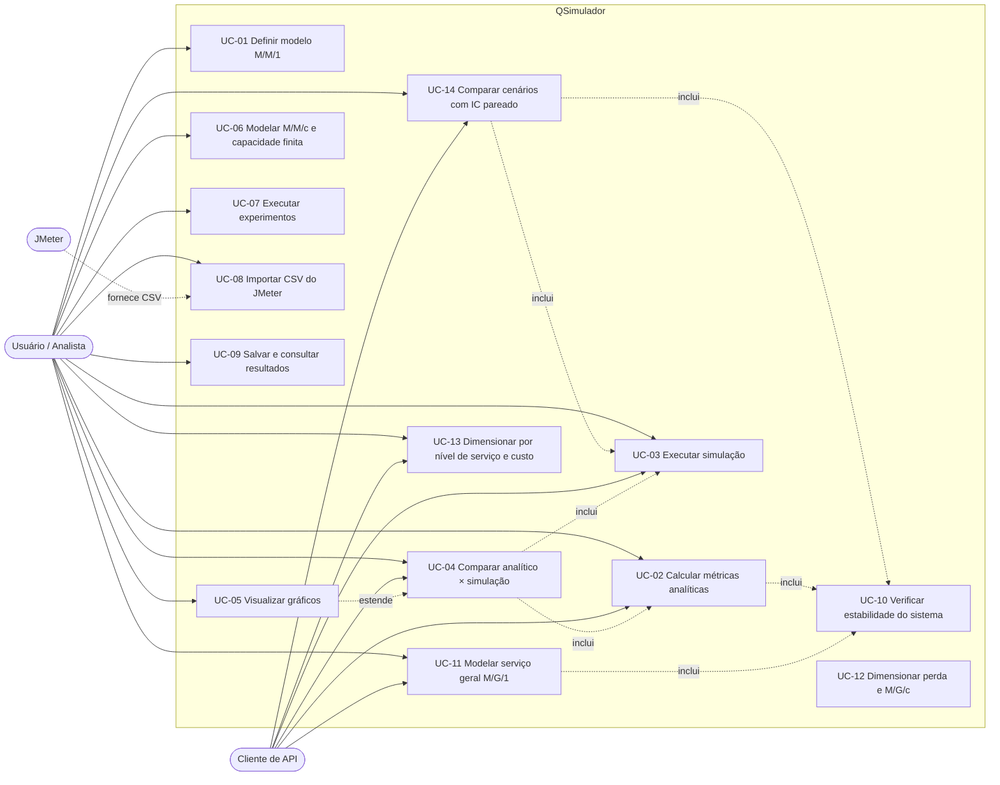

# Casos de Uso — QSimulador

Laboratório interativo de modelagem, simulação e análise de sistemas de filas, desenvolvido para a disciplina **Modelagem e Simulação de Sistemas Computacionais**.

Este documento descreve **quem usa o sistema, o que consegue fazer e como cada interação acontece**. Para instruções de execução, veja [`como-executar.md`](como-executar.md).

---

## 1. Atores

| Ator | Descrição |
|------|-----------|
| **Usuário (Analista)** | Estudante, professor ou pesquisador que modela um sistema de filas, simula e analisa resultados. É o ator principal. |
| **Cliente de API** | Script, ferramenta ou o frontend React que consome a API REST (FastAPI) diretamente. |
| **JMeter** *(externo, futuro)* | Ferramenta de teste de carga cujo CSV de resultados é importado para comparação com o modelo. |
| **Banco de dados** *(sistema, futuro)* | PostgreSQL, usado para persistir modelos, experimentos e resultados. |

---

## 2. Status de implementação

| Símbolo | Significado |
|---------|-------------|
| ✅ | Implementado e testado |
| 🚧 | Em desenvolvimento (etapa atual) |
| 📋 | Planejado no roadmap |

---

## 3. Visão geral dos casos de uso

### Resumo

| ID | Caso de uso | Ator principal | Status |
|----|-------------|----------------|--------|
| UC-01 | Definir parâmetros do modelo M/M/1 | Usuário | ✅ |
| UC-02 | Calcular métricas analíticas | Usuário, Cliente de API | ✅ |
| UC-03 | Executar simulação de eventos discretos | Usuário, Cliente de API | ✅ |
| UC-04 | Comparar resultado analítico × simulação | Usuário, Cliente de API | ✅ |
| UC-05 | Visualizar resultados em gráficos | Usuário | ✅ |
| UC-06 | Modelar M/M/c, M/M/1/K e M/M/c/K | Usuário | ✅ |
| UC-07 | Executar experimentos (varredura de parâmetros) | Usuário | ✅ |
| UC-08 | Importar CSV do JMeter e comparar com o modelo | Usuário | 📋 |
| UC-09 | Salvar e consultar modelos e resultados | Usuário | ✅ |
| UC-10 | Verificar estabilidade do sistema | Sistema (incluído) | ✅ |
| UC-11 | Modelar serviço geral (M/G/1 e M/D/1) | Usuário, Cliente de API | ✅ |
| UC-12 | Dimensionar sistema de perda (Erlang-B) e modelar M/G/c | Usuário, Cliente de API | ✅ |
| UC-13 | Dimensionar por nível de serviço e custo | Usuário, Cliente de API | ✅ |
| UC-14 | Comparar cenários com intervalo de confiança pareado | Usuário, Cliente de API | ✅ |

> **Conferência de 08/10/2026:** os casos de uso implementados (UC-01 a UC-06 e UC-10) foram verificados executando o sistema. As divergências encontradas na auditoria em UC-02 (P0 não retornado), UC-03 (a simulação aceitava 1 réplica) e UC-04 (P0 simulado) foram fechadas. Os detalhes estão na seção 11 de [`requisitos-do-sistema.md`](requisitos-do-sistema.md).

---

## 4. Especificação dos casos de uso

### UC-01 — Definir parâmetros do modelo M/M/1 ✅

| Campo | Descrição |
|-------|-----------|
| **Ator principal** | Usuário |
| **Objetivo** | Informar a taxa de chegada (λ) e a taxa de serviço (μ) do sistema a ser analisado. |
| **Pré-condições** | Nenhuma. |
| **Pós-condições** | Parâmetros validados e prontos para análise ou simulação. |

**Fluxo principal**
1. O usuário informa a taxa de chegada **λ** (clientes por unidade de tempo).
2. O usuário informa a taxa de serviço **μ** (clientes atendidos por unidade de tempo).
3. O sistema valida que λ > 0 e μ > 0.
4. O sistema aceita os parâmetros.

**Fluxos alternativos**
- **3a.** Valor ausente, não numérico, zero ou negativo → o sistema rejeita a requisição e informa qual campo é inválido.

**Regras de negócio**
- RN-01: λ e μ devem ser números reais estritamente positivos.

---

### UC-02 — Calcular métricas analíticas ✅

| Campo | Descrição |
|-------|-----------|
| **Ator principal** | Usuário, Cliente de API |
| **Objetivo** | Obter as métricas teóricas exatas do modelo M/M/1. |
| **Pré-condições** | Parâmetros válidos (UC-01). |
| **Pós-condições** | Métricas analíticas retornadas. |

**Fluxo principal**
1. O usuário solicita o cálculo analítico com λ e μ.
2. O sistema verifica a estabilidade do sistema (UC-10).
3. O sistema calcula as métricas: utilização (ρ), número médio no sistema (L), número médio na fila (Lq), tempo médio no sistema (W), tempo médio na fila (Wq) e probabilidade de sistema vazio (P0).
4. O sistema retorna as métricas.

**Fluxos alternativos**
- **2a.** Sistema instável (ρ ≥ 1) → o sistema informa que não existe regime estacionário e não retorna métricas médias.

**Regras de negócio**
- RN-02: as métricas são calculadas por fórmulas fechadas e devem satisfazer a **Lei de Little** (L = λW e Lq = λWq).

---

### UC-03 — Executar simulação de eventos discretos ✅

| Campo | Descrição |
|-------|-----------|
| **Ator principal** | Usuário, Cliente de API |
| **Objetivo** | Estimar as métricas do sistema por simulação (SimPy) com réplicas independentes. |
| **Pré-condições** | Parâmetros válidos (UC-01). |
| **Pós-condições** | Estimativas das métricas com intervalo de confiança retornadas. |

**Fluxo principal**
1. O usuário informa λ, μ e os parâmetros de simulação (duração, número de réplicas, semente, período de aquecimento).
2. O sistema executa as réplicas independentes com SimPy.
3. O sistema descarta o período de aquecimento e calcula as métricas de cada réplica.
4. O sistema agrega as réplicas e calcula média e **intervalo de confiança** de cada métrica.
5. O sistema retorna os resultados.

**Fluxos alternativos**
- **1a.** Parâmetros de simulação inválidos (ex.: número de réplicas menor que 2) → o sistema rejeita e informa o erro.
- **2a.** Mesma semente informada → o sistema produz resultados reproduzíveis.

**Regras de negócio**
- RN-03: cada réplica usa um fluxo de números aleatórios independente, derivado da semente.
- RN-04: o intervalo de confiança é calculado a partir da variação entre réplicas.

---

### UC-04 — Comparar resultado analítico × simulação ✅

| Campo | Descrição |
|-------|-----------|
| **Ator principal** | Usuário, Cliente de API |
| **Objetivo** | Validar a simulação contra o modelo teórico e quantificar a diferença. |
| **Pré-condições** | Sistema estável (ρ < 1) e parâmetros válidos. |
| **Pós-condições** | Comparação por métrica retornada. |

**Fluxo principal**
1. O usuário informa λ, μ e os parâmetros de simulação.
2. O sistema executa o cálculo analítico (UC-02).
3. O sistema executa a simulação (UC-03).
4. Para cada métrica, o sistema calcula o **erro relativo** entre o valor analítico e a média simulada.
5. O sistema indica se o valor analítico **cai dentro do intervalo de confiança** da simulação.
6. O sistema retorna a comparação consolidada.

**Fluxos alternativos**
- **2a.** Sistema instável → a comparação é recusada, pois não há valor analítico de referência.

**Regras de negócio**
- RN-05: erro relativo = |simulado − analítico| / |analítico|.
- RN-06: um valor analítico fora do IC sinaliza possível problema de calibração (duração curta, aquecimento insuficiente ou poucas réplicas).

---

### UC-05 — Visualizar resultados em gráficos ✅

| Campo | Descrição |
|-------|-----------|
| **Ator principal** | Usuário |
| **Objetivo** | Interpretar visualmente os resultados e a comparação. |
| **Pré-condições** | Resultado de comparação disponível (UC-04). |
| **Pós-condições** | Gráficos exibidos na interface web. |

**Fluxo principal**
1. O usuário preenche λ e μ no formulário da interface web (React).
2. O usuário aciona a análise.
3. O sistema obtém a comparação pela API (UC-04).
4. O sistema exibe gráficos (Plotly) com os valores analíticos, as médias simuladas e os intervalos de confiança de cada métrica.

**Fluxos alternativos**
- **3a.** Erro de validação ou sistema instável → a interface exibe mensagem clara e não renderiza gráficos.

---

### UC-06 — Modelar M/M/c, M/M/1/K e M/M/c/K ✅

| Campo | Descrição |
|-------|-----------|
| **Ator principal** | Usuário |
| **Objetivo** | Analisar sistemas com múltiplos servidores e/ou capacidade finita. |
| **Pré-condições** | Parâmetros válidos, incluindo número de servidores (c) e/ou capacidade (K). |
| **Pós-condições** | Métricas analíticas e simuladas para o modelo escolhido. |

**Fluxo principal**
1. O usuário escolhe o tipo de modelo (M/M/1, M/M/c, M/M/1/K ou M/M/c/K).
2. O usuário informa λ, μ e, conforme o modelo, c e/ou K.
3. O sistema calcula as métricas analíticas e executa a simulação.
4. Para modelos com capacidade finita, o sistema inclui a **probabilidade de bloqueio**.
5. O sistema retorna e compara os resultados.

---

### UC-07 — Executar experimentos (varredura de parâmetros) ✅

| Campo | Descrição |
|-------|-----------|
| **Ator principal** | Usuário |
| **Objetivo** | Observar como as métricas variam ao alterar um parâmetro (ex.: utilização). |
| **Pré-condições** | Modelo definido. |
| **Pós-condições** | Série de resultados por valor de parâmetro. |

**Fluxo principal**
1. O usuário escolhe o parâmetro a variar e define a faixa e o passo.
2. O sistema executa análise e simulação para cada valor da faixa.
3. O sistema consolida os resultados em uma tabela e em gráficos de tendência.

**Fluxos alternativos**
- **2a.** Valores da faixa que tornam o sistema instável são sinalizados e tratados sem interromper o experimento.

---

### UC-08 — Importar CSV do JMeter e comparar com o modelo 📋

| Campo | Descrição |
|-------|-----------|
| **Ator principal** | Usuário |
| **Ator secundário** | JMeter |
| **Objetivo** | Confrontar medições de um sistema real com as previsões do modelo. |
| **Pré-condições** | Arquivo CSV exportado do JMeter. |
| **Pós-condições** | Métricas empíricas calculadas e comparadas com o modelo. |

**Fluxo principal**
1. O usuário envia o arquivo CSV.
2. O sistema valida o formato e extrai tempos de resposta e vazão.
3. O sistema calcula as métricas empíricas.
4. O sistema compara as métricas empíricas com as do modelo escolhido.

**Fluxos alternativos**
- **2a.** CSV malformado ou sem as colunas esperadas → o sistema informa o problema e rejeita o arquivo.

**Regras de negócio**
- RN-07: testes do JMeter geralmente geram **sistema fechado** (número fixo de usuários), diferente do M/M/1 aberto; o sistema deve alertar sobre essa diferença e considerar o modelo M/M/1//N.

---

### UC-09 — Salvar e consultar modelos e resultados ✅

| Campo | Descrição |
|-------|-----------|
| **Ator principal** | Usuário |
| **Ator secundário** | Banco de dados |
| **Objetivo** | Guardar modelos, simulações e experimentos para consulta posterior. |
| **Pré-condições** | Resultado disponível para salvar. |
| **Pós-condições** | Registro persistido e recuperável. |

**Fluxo principal**
1. O usuário escolhe salvar um modelo ou resultado.
2. O sistema persiste os dados no PostgreSQL.
3. O usuário consulta o histórico e reabre um registro salvo.

**Fluxos alternativos**
- **2a.** Se o servidor não tem banco configurado, o botão de salvar não aparece e a aba Histórico informa que o recurso está indisponível; o restante do sistema funciona normalmente.
- **2b.** Se o banco está fora do ar, o limite de registros do navegador foi atingido ou o registro é grande demais, o sistema informa o motivo e nada é salvo.
- **3a.** O usuário pode renomear e excluir registros. Resultados do Laboratório voltam ao Laboratório, com o formulário preenchido; experimentos e análises do JMeter são mostrados na aba Histórico.

**Regras de negócio**
- RN-08: sem login, cada navegador tem um identificador anônimo e só vê os próprios registros. Isso organiza o histórico, mas não é autenticação.

---

### UC-10 — Verificar estabilidade do sistema ✅

| Campo | Descrição |
|-------|-----------|
| **Ator principal** | Sistema (caso de uso incluído por UC-02 e UC-04) |
| **Objetivo** | Garantir que as métricas de regime estacionário só sejam calculadas quando existem. |

**Fluxo principal**
1. O sistema calcula a utilização ρ = λ/μ.
2. Se ρ < 1, o sistema libera o cálculo.

**Fluxos alternativos**
- **2a.** Se ρ ≥ 1, o sistema interrompe o cálculo e informa que a fila cresce indefinidamente.

---

### UC-11 — Modelar serviço geral (M/G/1 e M/D/1) ✅

| Campo | Descrição |
|-------|-----------|
| **Ator principal** | Usuário, Cliente de API |
| **Objetivo** | Analisar uma fila de um servidor cujo tempo de serviço não é exponencial e ver o efeito da variabilidade (CV) na fila. |
| **Pré-condições** | λ válido, distribuição de serviço escolhida com parâmetros válidos e ρ = λ·E[S] < 1. |
| **Pós-condições** | Métricas analíticas (Pollaczek-Khinchine), simulação e comparação com IC, junto da média, do desvio padrão e do CV do serviço. |

**Fluxo principal**
1. O usuário escolhe o modelo M/G/1.
2. O usuário informa λ, escolhe a distribuição do serviço (determinística, exponencial, Erlang-k, lognormal, Weibull, uniforme, triangular ou normal truncada) e preenche os campos dela.
3. A interface mostra E[S], desvio padrão, CV, μ e ρ, e avisa que o modelo deixa de ser markoviano.
4. O sistema verifica a estabilidade (UC-10), calcula as métricas analíticas e executa a simulação com o serviço amostrado da distribuição.
5. O sistema compara analítico e simulação, com erro relativo e indicação de IC, e retorna os resultados.

**Fluxos alternativos**
- **Distribuição determinística:** o modelo é o M/D/1 e aparece com esse nome.
- **ρ ≥ 1 ou parâmetro inválido** (k não inteiro, mín > moda, valor não positivo): o sistema rejeita com mensagem que identifica o campo.

### UC-12 — Dimensionar sistema de perda (Erlang-B) e modelar M/G/c ✅

| Campo | Descrição |
|-------|-----------|
| **Ator principal** | Usuário, Cliente de API |
| **Objetivo** | Calcular o bloqueio de um sistema sem fila (ramais, leitos, vagas), achar o número de recursos para uma meta de bloqueio, ou analisar uma fila de vários servidores com serviço geral. |
| **Pré-condições** | λ, μ (ou a distribuição de serviço) e c válidos; no M/G/c, ρ = λ·E[S]/c < 1. |
| **Pós-condições** | Erlang-B: bloqueio, tráfego oferecido e carregado, utilização e vazão. M/G/c: métricas aproximadas, marca de aproximação e avisos de faixa. Simulação e comparação com IC nos dois modelos. |

**Fluxo principal (Erlang-B)**
1. O usuário escolhe o modelo Erlang-B (perda) e informa λ, μ e o número de servidores c.
2. Opcionalmente informa o bloqueio alvo e pede a sugestão de c; o sistema devolve o menor c que atende e o usuário pode aplicá-lo ao formulário.
3. O sistema calcula o bloqueio e as demais métricas, simula (motor M/M/c/K com K = c) e compara com o analítico.

**Fluxo principal (M/G/c)**
1. O usuário escolhe o modelo M/G/c, informa λ, c e a distribuição do serviço.
2. O sistema verifica ρ < 1, calcula pela aproximação de Allen–Cunneen e marca o resultado como aproximado, com avisos se ρ > 0,9 ou CV > 2.
3. Ao comparar, o sistema simula o M/G/c e mostra o erro da aproximação contra a simulação.

**Fluxos alternativos**
- **c = 1 ou serviço exponencial:** a fórmula coincide com o resultado exato (Pollaczek-Khinchine ou Erlang C) e a tela diz que é exata.
- **ρ ≥ 1 (M/G/c):** o sistema rejeita com erro identificando λ. O Erlang-B não tem condição de estabilidade.
- **Bloqueio alvo inatingível** (nem 1.000 servidores bastam) ou fora de (0, 1): erro identificando `target_blocking`.

---

### UC-13 — Dimensionar por nível de serviço e custo ✅

| Campo | Descrição |
|-------|-----------|
| **Ator principal** | Usuário, Cliente de API |
| **Objetivo** | Descobrir quantos servidores (atendentes, caixas, ramais) atendem a uma meta de nível de serviço ou de bloqueio, e qual número minimiza o custo total. |
| **Pré-condições** | Modelo e valores do Laboratório (λ, μ ou serviço, K quando houver); meta (t e P(Wq ≤ t), ou bloqueio alvo) e/ou custos hₛ, hₑ (e h_perda nos modelos com perda). |
| **Pós-condições** | Tabela por número de servidores (ρ, P(esperar), Lq, Wq, bloqueio, nível de serviço, custo), menor c que atinge a meta, c ótimo e gráfico custo × c; o resultado pode ser salvo no histórico como experimento do tipo `sizing`. |

**Fluxo principal**
1. O usuário abre a aba Dimensionamento, que herda o modelo e os valores do Laboratório.
2. Informa a meta (por exemplo, 80% atendidos em até 20 s) e os custos (por segundo, minuto ou hora; a interface converte).
3. Gera a tabela (padrão: c − 1 a c + 2 em torno do c do Laboratório), pede o menor c pela meta ou o custo mínimo.
4. O sistema mostra as linhas, destaca o c escolhido e as linhas instáveis e, no custo, o gráfico custo × c com a parcela de servidores, de espera e de perda.

**Fluxos alternativos**
- **M/M/1, M/M/1/K e M/G/1:** não têm c para dimensionar; a aba usa a família com c (M/M/c, M/M/c/K e M/G/c) com os mesmos parâmetros, e o c fica limitado a K no M/M/c/K.
- **Erlang-B:** não há espera; a meta é o bloqueio e o custo exige h_perda > 0 (sem ele o ótimo seria sempre c = 1).
- **M/G/c:** o nível de serviço usa uma cauda exponencial, exata só com CV = 1; o resultado é marcado como aproximação, com os avisos de faixa.
- **Meta inalcançável** (nem 1.000 servidores bastam, ou c > K): erro identificando o campo. **Faixa sem nenhum c estável** ou custos inválidos (hₛ ≤ 0): erro identificando o campo.
- **Ótimo na ponta da faixa pedida:** o sistema avisa que o verdadeiro pode estar fora da faixa.

---

### UC-14 — Comparar cenários com intervalo de confiança pareado ✅

| Campo | Descrição |
|-------|-----------|
| **Ator principal** | Usuário, Cliente de API |
| **Objetivo** | Saber se uma mudança (mais carga, mais um servidor, outro modelo, serviço mais variável) altera de verdade uma métrica, com rigor estatístico, e não só na média de uma rodada. |
| **Pré-condições** | Modelo e valores do Laboratório (a base) e a simulação do Laboratório (T, réplicas, warm-up, semente); de 1 a 10 cenários com as sobrescritas desejadas. |
| **Pós-condições** | Para cada cenário: média ± IC, analítico, diferença contra a base com IC pareado, variação relativa e veredito; alertas de instável e de risco; o resultado pode ser exportado em CSV e salvo no histórico como experimento do tipo `scenarios`. |

**Fluxo principal**
1. O usuário abre a aba Cenários, que herda o modelo, os valores e a simulação do Laboratório (a base).
2. Monta os cenários: nome e, em cada campo, o valor absoluto ou a variação em relação à base (por exemplo, λ +20%, c +1).
3. Executa todos. O sistema simula a base e cada cenário com as mesmas sementes (números aleatórios comuns) e mostra, conforme cada um termina, a linha na tabela e o progresso.
4. A tabela traz, para a métrica escolhida, a média ± IC, o analítico, a diferença com o IC pareado, a variação relativa e o veredito (aumento ou redução significativos, ou inconclusivo), e o gráfico mostra as diferenças com as barras de IC.
5. O usuário exporta o CSV ou salva a comparação no histórico.

**Fluxos alternativos**
- **Cenário instável (ρ ≥ 1, fila ilimitada):** não é simulado; sai destacado com o aviso. Nos modelos de capacidade finita não existe instabilidade.
- **Cenário em risco (ρ ≥ 0,9):** é simulado, com o aviso de que o resultado de regime depende de T e do warm-up.
- **Vários cenários:** os ICs são individuais, e a tela avisa. A correção de Bonferroni (opcional) divide α pelo número de cenários.
- **Troca de modelo:** as métricas que o modelo escolhido não define aparecem como “—”. Ao trocar de M/G para um modelo markoviano, o serviço vira exponencial com a mesma média.
- **Base instável, mais de 10 cenários, R acima de 100, comparação grande demais ou sobrescrita inválida (ex.: CV em modelo markoviano):** erro identificando o campo.
- **Cancelamento:** fechar a conexão interrompe o que falta; o que já terminou fica na tela até a nova execução.

---

## 5. Rastreabilidade

| Caso de uso | Fase do roadmap | Componentes principais |
|-------------|-----------------|------------------------|
| UC-01, UC-02, UC-10 | Fase 1 — M/M/1 analítico | Módulo analítico (NumPy/SciPy), API FastAPI |
| UC-03 | Fase 2 — Simulação | SimPy, API FastAPI |
| UC-04 | Fase 4 — Comparação | Módulo e endpoint de comparação |
| UC-05 | Fase 3 — Frontend | React + TypeScript, Plotly (requer CORS) |
| UC-06 | Fase 5 — Novos modelos | M/M/c, M/M/1/K, M/M/c/K |
| UC-07 | Fase 6 — Experimentos | Módulo de experimentos |
| UC-08 | Fase 7 — JMeter | Importador de CSV |
| UC-09 | Fase 8 — Persistência e deploy | PostgreSQL, Docker |
| UC-11 | Fase 9 — Serviço geral | Módulo de distribuições de serviço, M/G/1 analítico e simulado |
| UC-12 | Fase 10 — Erlang-B e M/G/c | Erlang-B (recursão estável), dimensionamento, Allen–Cunneen, simulação reaproveitando o motor do M/M/c/K |
| UC-13 | Fase 11 — Dimensionamento | Módulo de dimensionamento (Erlang C, M/M/c/K exato, cauda do M/G/c), rotas `/api/sizing`, aba Dimensionamento |
| UC-14 | Fase 12 — Comparação de cenários | Módulo de cenários (números aleatórios comuns, IC t pareado, veredito), rota `/api/scenarios` em NDJSON, exportação CSV, aba Cenários |

---

## 6. Requisitos transversais aos casos de uso

- **Reprodutibilidade:** simulações com a mesma semente devem gerar os mesmos resultados.
- **Validação de entrada:** toda entrada inválida deve gerar mensagem clara e identificar o campo.
- **Qualidade:** testes determinísticos com resposta exata, tolerâncias estatísticas calibradas pela variação entre sementes e verificação da Lei de Little.
- **Arquitetura:** monólito modular, executável localmente e via Docker.
