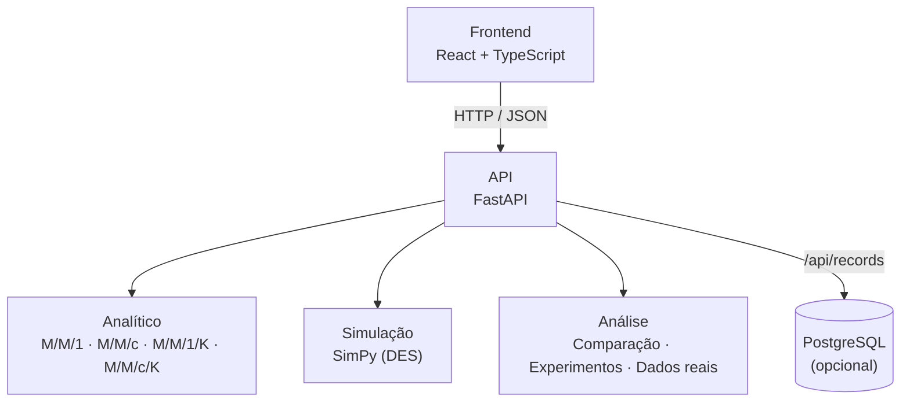

# QSimulador — Documentação acadêmica

Documento de apoio ao relatório da disciplina **Modelagem e Simulação de Sistemas Computacionais**. Reúne o problema, a fundamentação, a metodologia, a arquitetura, a validação e as limitações do QSimulador, com remissões aos documentos técnicos do repositório. Onde há números, eles vêm dos testes e das medições do próprio projeto; nada aqui foi estimado "de cabeça".

> **Autores:** Rafael Gomes de Araújo Melo, Mariana Oliveira Lima e João Lucas Cosme (UFRPE).
> **Licença e citação:** ver [`LICENSE`](../LICENSE).

## Sumário

1. [Resumo](#1-resumo)
2. [Problema e objetivos](#2-problema-e-objetivos)
3. [Fundamentação teórica](#3-fundamentação-teórica)
4. [Metodologia](#4-metodologia)
5. [Arquitetura e implementação](#5-arquitetura-e-implementação)
6. [Persistência e publicação (Fase 8)](#6-persistência-e-publicação-fase-8)
7. [Verificação e validação](#7-verificação-e-validação)
8. [Como reproduzir os resultados](#8-como-reproduzir-os-resultados)
9. [Limitações e ameaças à validade](#9-limitações-e-ameaças-à-validade)
10. [Trabalhos futuros](#10-trabalhos-futuros)
11. [Referências](#11-referências)
12. [Pendências do documento](#12-pendências-do-documento)

---

## 1. Resumo

O QSimulador é uma ferramenta web para modelar, simular e analisar sistemas computacionais com comportamento de filas (servidores web, APIs, bancos de dados). Ele integra, em um único fluxo, o cálculo analítico (modelos M/M/1, M/M/c, M/M/1/K e M/M/c/K), a simulação de eventos discretos com réplicas independentes e intervalos de confiança, a comparação entre os dois, experimentos do tipo "e se..." e a confrontação com dados reais exportados do Apache JMeter. Os resultados podem ser salvos em um banco PostgreSQL (opcional) e reabertos depois. O sistema está publicado na Vercel.

## 2. Problema e objetivos

Sistemas computacionais recebem requisições que precisam ser atendidas por recursos de capacidade limitada. Quando a taxa de chegada cresce, aparecem filas maiores, tempos de espera crescentes, utilização elevada e, no limite, saturação. Estudar esses efeitos em um sistema real é caro e arriscado; um modelo permite fazê-lo de forma controlada.

**Objetivo geral.** Oferecer uma plataforma experimental que permita construir um modelo de filas, obter suas métricas por duas vias independentes (analítica e simulada), verificar se concordam e confrontá-las com medições reais.

**Objetivos específicos.**

- Calcular as métricas analíticas de regime estacionário dos modelos implementados, recusando sistemas instáveis em vez de devolver números enganosos.
- Simular os mesmos modelos por eventos discretos, com réplicas independentes, reprodutibilidade por semente, descarte do transitório (warm-up) e intervalos de confiança.
- Comparar analítico e simulado métrica a métrica, com erro relativo e verificação do intervalo de confiança.
- Permitir experimentos de varredura de parâmetros, comparação de números de servidores e análise de sensibilidade.
- Importar dados do JMeter, recomendar o modelo de melhor ajuste e medir o erro do modelo em relação ao observado.
- Guardar resultados e reabri-los (Fase 8).

Os requisitos, casos de uso e histórias de usuário estão em [`requisitos-do-sistema.md`](requisitos-do-sistema.md), [`casos-de-uso.md`](casos-de-uso.md) e [`historias-de-usuario.md`](historias-de-usuario.md).

## 3. Fundamentação teórica

### 3.1 Notação de Kendall

Um sistema de filas é descrito por A/S/c/K/N/D: processo de chegadas, distribuição do tempo de serviço, número de servidores, capacidade total, população e disciplina de atendimento. Aqui, **M** indica o processo markoviano (chegadas de Poisson e serviços exponenciais). O QSimulador implementa M/M/1, M/M/c, M/M/1/K, M/M/c/K e, para dados de testes de carga, os modelos fechados M/M/1//N e M/M/c//N, sempre com disciplina FIFO (Kendall, 1953). O plano de evolução da notação está em [`arquitetura-notacao-kendall.md`](arquitetura-notacao-kendall.md).

### 3.2 M/M/1

Com $\lambda < \mu$, a utilização é $\rho = \lambda/\mu$ e

$$
L = \frac{\lambda}{\mu-\lambda},\quad L_q = \frac{\lambda^2}{\mu(\mu-\lambda)},\quad W = \frac{1}{\mu-\lambda},\quad W_q = \frac{\lambda}{\mu(\mu-\lambda)},\quad P_0 = 1-\rho .
$$

Se $\lambda \ge \mu$ a fila cresce sem limite e não há regime estacionário. O sistema devolve um erro explícito nesse caso.

### 3.3 Vários servidores e capacidade finita

Com $c$ servidores e carga oferecida $a=\lambda/\mu$, a probabilidade de espera do M/M/c é a fórmula de Erlang C, calculada pela recursão estável de Erlang B:

$$
B_0=1,\quad B_k=\frac{a\,B_{k-1}}{k+a\,B_{k-1}},\qquad C(c,a)=\frac{B_c}{1-\rho\,(1-B_c)} .
$$

Com capacidade finita $K$, a distribuição estacionária $p_n$ é proporcional a $a^n/n!$ para $0\le n\le c$ e a $a^n/(c!\,c^{n-c})$ para $c\le n\le K$, normalizada para somar 1. O bloqueio é $p_K$, a vazão efetiva é $\lambda_{ef}=\lambda(1-p_K)$ e o excesso de carga vira bloqueio, o que torna esses modelos estáveis mesmo com $\lambda\ge c\mu$. O cálculo é feito em escala logarítmica para evitar estouro numérico. As fórmulas completas e a tabela de métricas estão no [`README`](../README.md#vários-servidores-e-capacidade-finita).

### 3.4 Lei de Little

Para qualquer sistema estável, $L=\lambda W$ e $L_q=\lambda W_q$, com $\lambda$ substituído pela vazão efetiva $\lambda_{ef}$ quando há bloqueio (Little, 1961). O projeto a usa de duas formas: como **teste de consistência** das implementações e, nos dados reais, para obter $\hat L=\hat X\,\bar W$. Nesse segundo uso ela vale por definição e, por isso, **não é uma validação independente** (a interface avisa isso).

### 3.5 Simulação de eventos discretos e inferência

O estado do sistema muda apenas em eventos (chegada, início e término de atendimento, saída). O motor usa o SimPy. Para tratar a aleatoriedade, cada replicação tem um gerador próprio derivado de uma única semente; $L$, $L_q$ e $\rho$ são médias ponderadas pelo tempo, e $W$ e $W_q$ são médias por cliente. O período de warm-up é descartado para reduzir o viés do estado inicial vazio. Com $n$ réplicas independentes, o intervalo de confiança da média usa a distribuição $t$ de Student (padrão de 95 %), conforme a prática descrita em Law (2015) e Banks et al. (2010).

### 3.6 Sistemas abertos e fechados

O M/M/1 é um modelo **aberto**: as chegadas independem do estado do sistema. Um teste de carga com $N$ usuários simultâneos é **fechado**, porque cada usuário só envia a próxima requisição depois da resposta (e, opcionalmente, de um tempo de reflexão $Z$). Por isso o projeto classifica o teste do JMeter como aberto ou fechado e oferece M/M/1//N e M/M/c//N. Ver Harchol-Balter (2013) e Jain (1991) para a análise de sistemas fechados.

## 4. Metodologia

O projeto segue as etapas clássicas de um estudo de simulação:

```text
Problema → Abstração → Modelo matemático → Implementação
        → Simulação → Experimento → Análise → Validação
```

| Etapa | No QSimulador |
| --- | --- |
| Problema e abstração | Sistema computacional visto como fila com servidores, capacidade e taxas de chegada e de serviço |
| Modelo matemático | Fórmulas analíticas da seção 3, com recusa de parâmetros inválidos e de sistemas instáveis |
| Implementação | Funções analíticas, motor SimPy, módulo de comparação e API FastAPI |
| Simulação | Réplicas independentes, semente, warm-up e intervalos de confiança |
| Experimento | Varredura de λ, μ, c e K; comparação de servidores; sensibilidade; testes de carga reais |
| Análise | Erro relativo, verificação do IC, saturação e recomendação de modelo |
| Validação | Seção 7 |

Decisões metodológicas relevantes: réplicas entre 2 e 100 (o IC exige ao menos 2); limite de 1.000.000 de chegadas esperadas por réplica e de 5.000.000 no total, para proteger o servidor; mesma semente em todos os pontos de um experimento, para que diferenças venham dos parâmetros e não do acaso.

## 5. Arquitetura e implementação

O sistema é um **monólito modular**: interface, API, modelos matemáticos, simulação e análise ficam separados, e o núcleo não depende do banco de dados.



| Camada | Tecnologia | Observação |
| --- | --- | --- |
| Backend | Python, FastAPI, NumPy, SciPy, SimPy | Esquemas Pydantic; erros no formato `{code, message, fields?}` |
| Frontend | React, TypeScript (modo estrito), Plotly | Tipos gerados do `openapi.json`; um teste falha se ele ficar desatualizado |
| Persistência | PostgreSQL, SQLAlchemy 2, Alembic, psycopg 3 | Opcional (RNF-18) |
| Publicação | Vercel (frontend e backend) | Ver seção 6 |

A estrutura de pastas e a lista de rotas estão no [`README`](../README.md) e em [`como-executar.md`](como-executar.md).

## 6. Persistência e publicação (Fase 8)

**Decisões de projeto** e as razões:

| Decisão | Razão |
| --- | --- |
| PostgreSQL **opcional** | O núcleo (análise, simulação, comparação) deve funcionar sem banco (RNF-18); sem `QSIMULADOR_DATABASE_URL`, o histórico fica desativado e as rotas respondem 503 |
| **Uma tabela** (`saved_records`) com `params` e `result` em JSONB | Guarda o que a API devolveu, sem duplicar o esquema de cada modelo, e recupera os mesmos valores (RF-26). A ordem das chaves do objeto pode mudar (JSONB), sem alterar o significado |
| Tipos de registro: `model`, `simulation`, `comparison`, `experiment`, `realdata` | Cobrem os resultados do Laboratório, dos experimentos e da análise do JMeter |
| **Identificador anônimo por navegador**, sem login | Mantém o sistema simples e público; organiza o histórico por navegador, mas **não é autenticação**: não salve dados sigilosos |
| Limites de tamanho do registro (2 MB) e de registros por navegador (200) | Evitam abuso em um site público; configuráveis por variável de ambiente |
| Migrações com Alembic, aplicadas manualmente | Em serverless, cada instância nova rodaria a migração; manual é previsível |
| Configuração por variáveis de ambiente | Nenhuma credencial no código (RNF-26) |

**Publicação.** Frontend e backend são servidos pela Vercel (`vercel.json`). Como a Vercel não persiste arquivos, o banco é externo. O passo a passo está em [`como-executar.md`](como-executar.md#histórico-com-postgresql-fase-8).

**Pendente:** execução com Docker (RNF-17, US-25), adiada.

## 7. Verificação e validação

Distingue-se **verificação** (o código implementa corretamente o modelo?) de **validação** (o modelo representa o sistema real?).

### 7.1 Verificação

- **Casos conhecidos:** resultados comparados com valores calculados de forma independente (M/M/2, Erlang B, forma fechada do M/M/1/K) e com a resolução direta da cadeia de Markov.
- **Identidades:** Lei de Little (com a vazão efetiva) e $L=L_q+\rho$, $W=W_q+1/\mu$.
- **Reduções entre modelos:** M/M/c com $c=1$ equivale ao M/M/1; capacidade grande tende ao M/M/c.
- **Simulação:** casos determinísticos com resposta exata (chegadas a cada 1,0 e serviço de 0,5; um sistema de perda que recusa 2 de cada 3 chegadas), crescimento da fila sob sobrecarga, efeito do warm-up e reprodutibilidade por semente.
- **Concordância estatística:** a simulação é comparada com o analítico com tolerâncias calibradas pela variação entre sementes; nos testes de cobertura, os ICs de 95 % contiveram o valor analítico na proporção esperada.
- **Conformidade com a especificação:** $P_0$ conferido com aritmética exata de frações; limites de réplicas e de chegadas; campo identificado em cada erro.
- **Cobertura (RNF-29)**, medida pelo projeto: `analytical` 100 %, `simulation` 99,6 %, `analysis` 100 %, `domain` 99,2 % e `api` 100 % (critério: ≥ 85 %). Ver [`requisitos-do-sistema.md`](requisitos-do-sistema.md).

### 7.2 Validação com dados reais

A Fase 7 fecha o ciclo modelo analítico × simulação × medição. O erro relativo toma o valor **medido** como referência:

$$
\text{erro relativo}=\frac{|\,valor_{modelo}-valor_{observado}\,|}{valor_{observado}}\times 100 .
$$

A análise do CSV do JMeter verifica os dados, classifica o teste (aberto ou fechado), estima $\mu$, $c$, $Z$ e $K$, e recomenda o modelo por um conjunto de critérios com ranking e nível de confiança. Quando nenhum modelo se ajusta bem, o sistema diz isso em vez de forçar uma recomendação.

### 7.3 Testes da Fase 8

- **Backend:** rotas do histórico (salvar, listar, filtrar, paginar, reabrir, renomear, excluir), isolamento entre navegadores, validação, limites, banco desativado, banco fora do ar, migração esquecida e CORS. Os mesmos testes rodam em SQLite e em **PostgreSQL 16 real**, e a migração é aplicada (subida e descida) no teste de PostgreSQL. Os dados voltam iguais ao que foi gravado, inclusive números de ponto flutuante.
- **Frontend:** fluxos completos de salvar, listar, reabrir, renomear e excluir, com os dois estados do histórico (ativo e desativado), erros do servidor e registros de formato desconhecido. O teste de contrato roda o mesmo cliente contra a API real com banco.

## 8. Como reproduzir os resultados

```bash
# Backend (a partir de backend/)
python -m venv .venv && source .venv/bin/activate     # Windows: .venv\Scripts\Activate.ps1
pip install -r requirements-dev.txt
python -m pytest
python -m examples.mm1_demo
python -m uvicorn app.main:app --reload

# Frontend (a partir de frontend/)
npm install
npm test
npm run dev
```

Para fixar uma simulação, use a mesma **semente**: o resultado é idêntico. O histórico exige um PostgreSQL (ver seção 6). Instruções completas em [`como-executar.md`](como-executar.md).

## 9. Limitações e ameaças à validade

- **Premissas markovianas.** Chegadas de Poisson e serviços exponenciais raramente descrevem um sistema real por inteiro. Divergências entre modelo e medição podem vir dessa diferença estrutural, e não de erro de implementação.
- **Sistemas abertos × fechados.** Testes de carga costumam ser fechados; o λ a comparar deve vir da vazão medida. A latência medida inclui rede e componentes que o modelo não representa.
- **Lei de Little nos dados reais.** $\hat L=\hat X\bar W$ vale por definição; não valida o modelo.
- **Estado estacionário.** As métricas analíticas são de regime estacionário; testes curtos podem estar no transitório.
- **Simulação.** Os ICs assumem réplicas independentes e aproximadamente normais; com poucas réplicas ou simulação curta, o IC é pouco confiável (o sistema recusa menos de 2 réplicas).
- **Desempenho.** As réplicas ainda não rodam em paralelo (RNF-11).
- **Histórico.** Sem autenticação; o identificador anônimo não protege contra quem o conhecer. A importação por níveis de carga (CSV agregado) ainda não é salva. O histórico foi testado em SQLite e em PostgreSQL 16 local; a combinação específica Vercel + provedor de banco deve ser conferida após a configuração.
- **Itens abertos de qualidade:** ver a seção 11.3 de [`requisitos-do-sistema.md`](requisitos-do-sistema.md) (por exemplo, versões fixas das dependências, linter e logs).

## 10. Trabalhos futuros

Docker (`docker compose up`); autenticação e histórico por usuário; salvar a importação de níveis de carga; outras disciplinas de atendimento e distribuições além da exponencial; redes de filas; análise de regime transiente; execução paralela das réplicas; usabilidade testada com pessoas (RNF-13).

## 11. Referências

Conferir o formato exigido pela disciplina (por exemplo, ABNT) e os dados das edições usadas.

- BANKS, J.; CARSON, J. S.; NELSON, B. L.; NICOL, D. M. **Discrete-Event System Simulation**. 5. ed. Upper Saddle River: Pearson, 2010.
- HARCHOL-BALTER, M. **Performance Modeling and Design of Computer Systems: Queueing Theory in Action**. Cambridge: Cambridge University Press, 2013.
- JAIN, R. **The Art of Computer Systems Performance Analysis**. New York: Wiley, 1991.
- KENDALL, D. G. Stochastic processes occurring in the theory of queues and their analysis by the method of the imbedded Markov chain. **The Annals of Mathematical Statistics**, v. 24, n. 3, p. 338–354, 1953.
- KLEINROCK, L. **Queueing Systems, Volume I: Theory**. New York: Wiley, 1975.
- LAW, A. M. **Simulation Modeling and Analysis**. 5. ed. New York: McGraw-Hill, 2015.
- LITTLE, J. D. C. A proof for the queuing formula: L = λW. **Operations Research**, v. 9, n. 3, p. 383–387, 1961.

## 12. Pendências do documento


- Contato dos autores e foro (cidade/UF) na licença; dados de citação (ano, URL e data de acesso) em `LICENSE` e no README.
- Resultados do estudo de caso da disciplina (por exemplo, o teste de carga real analisado e as conclusões), para uma seção própria de resultados.