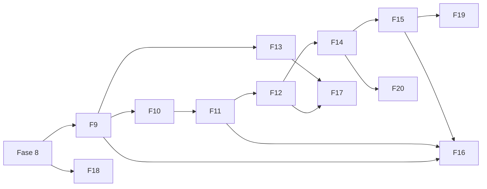

# Roadmap competitivo do QSimulador (Fases 9 a 20)

| Campo | Valor |
|---|---|
| Versão | 1.0 |
| Data | 16/10/2026 |
| Origem | [analise-concorrente.md](analise-concorrente.md) (lacunas L-01 a L-17) |
| Valores de teste | [valores-de-referencia.md](valores-de-referencia.md) |
| Pré-requisito | Fase 8 concluída (persistência com Neon, aba Histórico, documentação acadêmica, arquivo LICENSE) |

> **Sobre os identificadores.** Os requisitos e histórias deste documento usam IDs **provisórios** (`RFC-nn`, `RNC-nn`, `USC-nn`) para não colidir com os de [requisitos-do-sistema.md](requisitos-do-sistema.md) e [historias-de-usuario.md](historias-de-usuario.md). Ao fechar cada fase, eles são renumerados e incorporados a esses documentos (nova versão do requisitos-do-sistema.md).
>
> **Sobre as rotas.** Os caminhos de API citados são **propostas** no padrão `/api/models/{modelo}/...`. Devem ser alinhados à convenção real do repositório no início de cada fase, sem alterar rotas e esquemas existentes.

---

## 1. Visão geral das fases

Cada fase foi dimensionada para caber em **um chat de trabalho** (plano, implementação, testes, teste por HTTP e documentação). Esforço: **P** pequeno, **M** médio, **G** grande.

| Fase | Título | Lacunas | Esforço | Marco |
|---|---|---|---|---|
| 9 | Serviço geral: M/D/1 e M/G/1 ✅ | L-01, L-02 | M | M1 |
| 10 | Erlang-B dedicado e M/G/c ✅ | L-03, L-04 | M | M1 |
| 11 | Dimensionamento, nível de serviço e custo ✅| L-05, L-06 | M | M1 |
| 12 | Comparação de cenários ✅| L-07 | M | M2 |
| 13 | Gráficos de distribuição e ajuste de amostras ✅ | L-08, L-09 | M | M2 |
| 14 | Chegadas variáveis (NHPP) e warm-up | L-10, L-11 | M | M2 |
| 15 | Prioridades e tipos de entidade | L-12 | G | M2 |
| 16 | Didática: cenários prontos, tutorial e guia | L-13, L-14 | M | M3 |
| 17 | Relatório em PDF e animação da fila | L-15, L-16 | M | M3 |
| 18 | Docker, qualidade e publicação | pendências do projeto | M | M4 |
| 19 | Redes de filas | L-17 (parte) | G | M5 (opcional) |
| 20 | Turnos, falhas e abandono | L-17 (parte) | G | M5 (opcional) |
| 21 | Testes de hipótese e validação estatística | L-18 | M | M2 (executar após as Fases 12 e 13) |

### Marcos

| Marco | Fases | Resultado para o usuário |
|---|---|---|
| M1: paridade analítica | 9 a 11 | Todos os modelos analíticos do concorrente, mais dimensionamento por SLA e custo |
| M2: paridade estatística | 12 a 15 | Cenários com IC, gráficos de distribuição, ajuste de amostras, NHPP, warm-up, prioridades |
| M3: experiência | 16 e 17 | Cenários prontos, tutorial, guia, PDF e animação |
| M4: publicação | 18 | Docker, integração contínua e pendências técnicas fechadas |
| M5: estratégico | 19 e 20 | Redes, turnos, falhas e abandono (opcionais) |

### Dependências

Observações:

- A Fase 18 depende só da Fase 8 e **pode ser antecipada** (decisão D-04 da análise).
- As Fases 13 e 14 podem ser trocadas de ordem sem prejuízo.
- As Fases 19 e 20 são opcionais; o projeto já é competitivo ao fim da Fase 17.

---

## 2. Definição de pronto (vale para todas as fases)

1. Testes do backend (`python -m pytest`) e do frontend (Vitest) passando, com o total de testes informado na entrega.
2. Teste por HTTP com `python -m uvicorn` para cada rota nova, com os comandos usados.
3. Cada fórmula nova tem teste com **valor de referência** de [valores-de-referencia.md](valores-de-referencia.md), recalculado no teste por método independente.
4. Simulações: tolerâncias estatísticas calibradas pela variação entre sementes (nunca valores exatos de números aleatórios) e verificação da Lei de Little.
5. Resultados aproximados trazem o rótulo "aproximação" na API e na interface.
6. Rotas e esquemas existentes continuam funcionando (sem quebra de compatibilidade).
7. Documentação atualizada: `README.md`, `docs/como-executar.md`, `docs/requisitos-do-sistema.md`, `docs/casos-de-uso.md`, `docs/historias-de-usuario.md` e este roadmap (status da fase).
8. Entrega em `.zip` com caminhos relativos à raiz do repositório, listando arquivos **novos** e **alterados**, e comandos para PowerShell.
9. Antes da implementação: plano em poucas linhas com as decisões relevantes, para aprovação.

---

## 3. Requisitos transversais propostos

| ID | Requisito |
|---|---|
| RNC-01 | Toda fórmula nova possui valor de referência conferido por método independente |
| RNC-02 | Resultado aproximado é marcado com `exact: false` na API e com rótulo na interface, com a faixa de validade documentada |
| RNC-03 | Rotas e esquemas existentes não mudam; novas funções entram por rotas novas ou campos opcionais |
| RNC-04 | Toda entrada que pode crescer (réplicas, eventos, nós, cenários, períodos) tem limite configurável e erro identificado ao excedê-lo |
| RNC-05 | Todo exemplo numérico exibido em cenário pronto, tutorial ou guia é gerado ou verificado por teste automatizado |

---

## Fase 9: Serviço geral (M/D/1 e M/G/1)

| Item | Valor |
|---|---|
| Status | ✅ Concluída em 16/10/2026 (QSimulador 1.6) |
| Lacunas | L-01, L-02 |
| Esforço / prioridade | M / Alta |
| Depende de | Fase 8 |
| Requisitos | RFC-01 a RFC-06 (oficiais: RF-45 a RF-50) |
| História | USC-09: como estudante, quero escolher uma distribuição para o tempo de serviço e ver o efeito da variabilidade (CV) na fila, para entender por que a variância importa |

### Objetivo

Sair da suposição de serviço exponencial. Permitir serviço determinístico e geral para **um servidor**, com fórmula exata (Pollaczek-Khinchine) e simulação.

### Entregas

**Backend**

- Módulo de distribuições de serviço: determinística, exponencial, Erlang-k, lognormal, Weibull, uniforme, triangular e normal truncada. Cada uma devolve média, variância, CV e amostrador.
- Analítico M/D/1 e M/G/1: ρ, P₀, L, Lq, W, Wq a partir de λ, média e variância do serviço.
- Simulação SimPy com tempo de serviço amostrado da distribuição escolhida.
- Comparação analítico × simulação reaproveitando o módulo da Fase 4 (erro relativo e indicação de IC).
- Validação com erros identificados: ρ ≥ 1, k inteiro e ≥ 1, mín ≤ moda ≤ máx, parâmetros positivos.

**API (propostas)**: `POST /api/models/mg1/analytic`, `/simulate`, `/compare`; `GET /api/distributions` (lista e parâmetros).

**Interface**: seletor "Distribuição do tempo de serviço" no formulário; campos dinâmicos por distribuição; exibição de média, desvio padrão e CV; aviso quando o modelo deixa de ser markoviano.

### Registro da execução

- **Rotas:** seguiram a convenção do repositório, `POST /api/models/mg1/calculate`, `/simulate` e `/compare` (e não `/analytic`), mais `GET /api/distributions`. Nenhuma rota anterior mudou.
- **Identificadores oficiais:** RFC-01 a RFC-06 viraram RF-45 a RF-50 (requisitos-do-sistema.md, seção 4.11); USC-09 virou US-29 (épico E10) e o caso de uso é o UC-11.
- **Parametrização:** média (`mean`) ou taxa (`mu`) mais a forma (`k` ou `cv`) para exponencial, determinística, Erlang-k, lognormal e Weibull; parâmetros próprios para uniforme, triangular e normal truncada, com média e μ calculados. A normal truncada usa a média e a variância da distribuição truncada.
- **Interface:** o M/G/1 é um modelo do Laboratório (seletor de distribuição, campos dinâmicos, resumo de E[S], desvio padrão, CV, μ e ρ, e aviso de modelo não markoviano). Experimentos e Dados reais continuam só para os modelos markovianos.
- **Validação:** valores exatos da seção 5 de [valores-de-referencia.md](valores-de-referencia.md) reproduzidos (M/D/1: Wq = 22,5 s; M/G/1: Lq = 2,6042), mais as propriedades CV = 1 e CV = 0.

### Fora de escopo

M/G/c (Fase 10); ajuste de distribuição a partir de amostras (Fase 13); chegadas não Poisson.

### Testes

- M/G/1 com CV = 1 reproduz o M/M/1; com CV = 0 reproduz o M/D/1 (propriedades de [valores-de-referencia.md](valores-de-referencia.md), seção 8).
- Valores exatos: M/D/1 (λ = 40, μ = 80: Wq = 22,5 s) e M/G/1 (λ = 25, μ = 30, CV = 0,5: Lq = 2,6042).
- Para cada distribuição: média e variância empíricas de uma amostra grande dentro de tolerância calibrada por semente.
- Simulação × analítico com IC e Lei de Little.

### Critérios de aceite

- Os valores da seção 5 de [valores-de-referencia.md](valores-de-referencia.md) são reproduzidos.
- As oito distribuições funcionam na simulação e na interface.
- Nenhuma rota anterior muda.

---

## Fase 10: Erlang-B dedicado e M/G/c

| Item | Valor |
|---|---|
| Lacunas | L-03, L-04 |
| Esforço / prioridade | M / Alta |
| Depende de | Fase 9 |
| Status | ✅ Concluída em 20/10/2026 (QSimulador 1.7) |
| Requisitos | RFC-07 a RFC-11 (oficiais: RF-51 a RF-55; mais RF-56, experimentos do M/G/1) |
| História | USC-10: como analista de capacidade, quero calcular bloqueio e o número de recursos para uma meta de bloqueio, para dimensionar ramais, leitos ou licenças |

### Objetivo

Expor o sistema de perda pura como modelo de primeira classe e estender o serviço geral para vários servidores, **com o erro da aproximação medido**.

### Entregas

**Backend**

- Erlang-B (M/M/c/c): bloqueio, tráfego oferecido e carregado, utilização por servidor, recursão estável para c grande.
- Inverso do Erlang-B: menor c que atende um bloqueio alvo.
- M/G/c por Allen–Cunneen: Lq ≈ Lq(M/M/c)·(1+CV²)/2, marcado como aproximação.
- Simulação M/G/c e comparação com IC; relatório do erro da aproximação contra a simulação.
- Aviso de faixa de validade (ρ muito alto ou CV extremo), conforme decisão D-01 da análise.

**API (propostas)**: `POST /api/models/erlangb/analytic|simulate|compare`, `POST /api/models/erlangb/size`, `POST /api/models/mgc/analytic|simulate|compare`.

**Interface**: modelos "Erlang-B (perda)" e "M/G/c" no seletor; campo "bloqueio alvo" que sugere c; selo "aproximação" no M/G/c com o erro medido.

### Registro da execução

- **Rotas:** convenção do repositório, `POST /api/models/erlangb/calculate`, `/simulate`, `/compare` e `/size`, e `POST /api/models/mgc/calculate`, `/simulate` e `/compare` (e não `/analytic`). Nenhuma rota anterior mudou.
- **Identificadores oficiais:** RFC-07 a RFC-11 viraram RF-51 a RF-55 (requisitos-do-sistema.md, seção 4.12); USC-10 virou US-30 e o caso de uso é o UC-12.
- **Erlang-B:** módulo próprio (recursão estável), conferido contra o M/M/c/K com K = c, que também é o motor da simulação. O bloqueio é insensível à distribuição do serviço. A comparação omite P₀ quando ele é menor que 1e-4, porque "sistema vazio" é raro demais para a simulação observar (com 20 Erlangs e 15 servidores, P₀ ≈ 1e-8); o valor analítico continua no `/calculate`.
- **M/G/c:** Allen–Cunneen, sem P₀ nem P(n); entram ρ, L, Lq, W, Wq, vazão e P(esperar) (Erlang C). A resposta traz `exact` (verdadeiro com c = 1 ou CV = 1, em que a fórmula é a de Pollaczek-Khinchine ou a do M/M/c) e `warnings` (ρ > 0,9 ou CV > 2, limiares propostos). Com λ = 80, c = 10, E[S] = 0,1 e CV = 1,5, a aproximação ficou cerca de 15% acima da simulação em Lq; com serviço determinístico, cerca de 6% abaixo.
- **Interface:** modelos "Erlang-B (perda)" e "M/G/c" no seletor, campo "Bloqueio alvo" que sugere c e aplica ao formulário, nota de aproximação (exata ou aproximada, com os avisos) no M/G/c. Experimentos continuam só para os markovianos e o M/G/1.
- **Experimentos do M/G/1 (acréscimo pedido na aprovação do plano):** varredura de λ, μ (muda a escala do serviço e preserva o CV) e da variabilidade (CV na lognormal e na Weibull, k no Erlang), sensibilidade a esses parâmetros, e a nova aba "Comparar distribuições" (`POST /api/experiments/services`), com a mesma média e curvas de determinística, Erlang-4, exponencial e lognormais (CV 1,5 e 2).
- **Validação:** os 15 valores da seção 2 de [valores-de-referencia.md](valores-de-referencia.md), o exemplo M/M/15/15 (bloqueio de 33%), as propriedades (monotonicidade, M/M/c/K com K = c, CV = 1 e c = 1 do M/G/c) e a simulação contra o analítico.

### Fora de escopo

Dimensionamento com custo e SLA (feito na Fase 11); Engset (já coberto por M/M/c//N); experimentos do Erlang-B e do M/G/c (feitos na Fase 11).

### Testes

- Valores da seção 2 de [valores-de-referencia.md](valores-de-referencia.md) (Erlang-B).
- M/M/c/K com K = c coincide com Erlang-B.
- Monotonicidade do Erlang-B em c e em a.
- M/G/c com CV = 1 coincide com M/M/c.
- Simulação M/G/c: erro da aproximação dentro de uma faixa documentada por testes para ρ ≤ 0,9.

### Critérios de aceite

- Exemplos de PABX, UTI e estacionamento (M/M/15/15) reproduzem os valores corretos.
- A interface mostra claramente o que é exato e o que é aproximado.

---

## Fase 11: Dimensionamento, nível de serviço e custo

| Item | Valor |
|---|---|
| Lacunas | L-05, L-06 |
| Esforço / prioridade | M / Alta |
| Depende de | Fase 10 |
| Status | ✅ Concluída em 21/10/2026 (QSimulador 1.8) |
| Requisitos | RFC-12 a RFC-16 (oficiais: RF-59 a RF-63; mais RF-57 e RF-58, experimentos do Erlang-B e do M/G/c, e a US-32 e a US-33; caso de uso UC-13) |
| História | USC-11: como gerente de operação, quero saber quantos atendentes preciso para cumprir um SLA e qual o custo total, para justificar a contratação |

### Objetivo

Transformar o simulador em ferramenta de **decisão**: quantos servidores, a que custo e com que nível de serviço.

### Entregas

**Backend**

- Tabela de dimensionamento para uma faixa de c (padrão: c−1 a c+2) com ρ, P(esperar), Lq, Wq e bloqueio quando aplicável.
- Nível de serviço P(Wq ≤ t) e menor c que atinge a meta (por exemplo, 80% em 20 s).
- Custo total C(c) = c·hₛ + λ·Wq(c)·hₑ e c ótimo; destaque das linhas instáveis.
- Dimensionamento por bloqueio alvo integrado ao Erlang-B (Fase 10).

**API (propostas)**: `POST /api/sizing/table`, `POST /api/sizing/sla`, `POST /api/sizing/cost`.

**Interface**: aba "Dimensionamento" com a tabela, campos de SLA e de custos, destaque da linha ótima e das instáveis, gráfico de custo × c.

### Decisões tomadas

- **Etapa 1, experimentos em todos os modelos:** Erlang-B (varredura de λ, μ e c com K = c; comparar servidores como a curva de Erlang; sensibilidade a λ, μ e c ±1) e M/G/c (varredura de λ, μ, c, CV ou k; comparar servidores e distribuições com c fixo; sensibilidade a λ, μ, c ±1 e CV). Ficaram de fora: comparar distribuições no Erlang-B (o bloqueio só depende da média do serviço, então todas as curvas coincidiriam) e a aba Dados reais para esses modelos (exige ajustar uma distribuição aos dados, o que é a Fase 13).
- **Modelos de um servidor:** M/M/1, M/M/1/K e M/G/1 não têm c; a aba usa a família com c (M/M/c, M/M/c/K e M/G/c) com os mesmos parâmetros, e no M/M/c/K o c fica limitado a K.
- **Custo com perda:** nos modelos com bloqueio entra o termo opcional λ·B·h_perda, e o custo de espera usa a vazão λ(1 − B). No Erlang-B o custo exige h_perda > 0.
- **Unidades:** a API usa a mesma unidade de tempo de λ e μ; a interface converte custos por segundo, minuto ou hora.
- **M/G/c:** nível de serviço pela cauda exponencial P(Wq>t) ≈ P(esperar)·exp(−t·P(esperar)/Wq), exata com CV = 1, rotulada como aproximação.
- **Histórico:** o dimensionamento é salvo como experimento do tipo `sizing` (kind `experiment`), sem mudar o esquema do banco.

### Fora de escopo

Custo com abandono (Fase 20); dimensionamento por turno (Fase 20).

### Testes

- Seção 3 de [valores-de-referencia.md](valores-de-referencia.md): menor c para SLA 80/20 é 9.
- Seção 7: c ótimo = 12 e custos por linha.
- Nível de serviço cresce com c; linha instável nunca é escolhida como ótima.

### Critérios de aceite

- A tabela reproduz os valores de referência.
- Mudar hₛ ou hₑ move o ótimo de forma coerente (teste de sensibilidade).

---

## Fase 12: Comparação de cenários

| Item | Valor |
|---|---|
| Lacunas | L-07 |
| Esforço / prioridade | M / Alta |
| Depende de | Fase 11 (e do mecanismo de experimentos da Fase 6) |
| Status | ✅ Concluída em 23/10/2026 (QSimulador 1.9) |
| Requisitos | RFC-17 a RFC-21 (oficiais: RF-64 a RF-71; caso de uso UC-14; história US-34) |
| História | USC-12: como pesquisador, quero comparar configurações alternativas com intervalo de confiança, para saber se a diferença é estatisticamente real |

### Objetivo

Comparar cenários nomeados (por exemplo, "λ +20%", "mais 1 servidor") com rigor estatístico.

### Entregas

**Backend**

- Cenário = conjunto de sobrescritas (λ, μ, c, K, modelo) sobre uma configuração base.
- R réplicas por cenário, **com a mesma semente** (números aleatórios comuns), resposta em streaming e cancelamento (padrão da Fase 6).
- IC 95% por cenário (t-Student, R−1 graus de liberdade) e **IC da diferença pareada** contra a base, que é mais poderoso do que verificar se dois ICs se sobrepõem.
- Analítico ao lado do simulado; marcação de cenário instável (ρ ≥ 1) e em risco (ρ ≥ 0,9).
- Limite de cenários e de réplicas (RNC-04).

**API**: `POST /api/scenarios/compare` (NDJSON, um evento por cenário concluído) e `POST /api/scenarios/export.csv`. A exportação é `POST` porque a lista de cenários não cabe numa requisição `GET`.

**Decisões da implementação**: fluxos separados de chegada e serviço por réplica (serviço sorteado por número do cliente) só no caminho de comparação, sem mudar os resultados das fases anteriores; modelo como sobrescrita (os sete modelos, métricas inexistentes como “—”) e CV/k do serviço nos modelos M/G; correção de Bonferroni opcional (desligada); cenário instável não é simulado; teto de trabalho igual ao dos experimentos.

**Interface**: aba "Cenários" com lista editável, botão de executar todos, tabela com ICs e cores de alerta, exportação em CSV e salvamento no histórico (Fase 8).

### Fora de escopo

Otimização automática; cenários com mais de um modelo ao mesmo tempo além da sobrescrita simples.

### Testes

- Dois cenários idênticos com a mesma semente têm diferença exatamente zero.
- Cobertura do IC: em muitas repetições com sementes distintas, a taxa de cobertura do valor analítico fica dentro da faixa calibrada.
- Cenário instável é sinalizado; CSV tem cabeçalho e linhas esperados.

### Critérios de aceite

- A diferença pareada é calculada e exibida com IC.
- O usuário distingue "diferença significativa" de "inconclusivo".

---

## Fase 13: Gráficos de distribuição e ajuste de amostras

| Item | Valor |
|---|---|
| Lacunas | L-08, L-09 |
| Esforço / prioridade | M / Média |
| Depende de | Fase 9 |
| Status | ✅ Concluída em 26/10/2026 (QSimulador 2.0) |
| Requisitos | RFC-22 a RFC-26 (oficiais: RF-72 a RF-82; caso de uso UC-15; história US-35) |
| História | USC-13: como estudante, quero ver a distribuição do número de clientes e do tempo de espera, e descobrir se meus dados seguem uma distribuição conhecida, para escolher o modelo certo |

### Objetivo

Mostrar **distribuições** e não só médias, e ligar os dados reais (Fase 7) à escolha do modelo.

### Entregas

**Backend**

- P(n) analítica para M/M/1, M/M/c, M/M/1/K e M/M/c/K; P(Wq > t) para M/M/c (fórmula) e por histograma na simulação.
- Sensibilidade Wq × λ ao redor da configuração atual.
- Ajuste de amostra por máxima verossimilhança: exponencial, Erlang-k, lognormal, Weibull e uniforme; CV, AIC e p-valor de aderência (decisão D-02: Monte Carlo ou Lilliefors, **não** KS simples com parâmetro estimado).
- Sugestão de modelo (M/M/c, M/D/c, M/G/c) a partir do CV, integrada ao recomendador de modelo e à aba "Dados reais".

**API (propostas)**: `POST /api/analysis/distribution`, `POST /api/analysis/fit`, `POST /api/analysis/sensitivity`.

**Interface**: gráficos P(n), P(Wq > t) e sensibilidade com ponto da configuração atual; painel "Ajustar distribuição" com colar ou importar amostra, histograma com curva ajustada e tabela de candidatas.

### Fora de escopo

Mistura de distribuições; ajuste de processos de chegada não Poisson.

### Testes

- P(n) soma 1 (tolerância); P(0) = 1 − ρ no M/M/1.
- Amostras sintéticas de cada distribuição: o ajuste recupera os parâmetros dentro de tolerância calibrada por semente e a distribuição verdadeira não é rejeitada na proporção esperada.
- Amostra exponencial: CV ≈ 1 e sugestão M/M/c; amostra constante: sugestão M/D/c.

### Critérios de aceite

- Os três gráficos aparecem para os modelos aplicáveis.
- O ajuste informa claramente quando **nenhuma** candidata é adequada.

### Resultado e medições (26/10/2026)

O escopo foi entregue inteiro, em duas etapas no mesmo pacote (motor estatístico e depois API, interface, histórico e documentação). O que mudou em relação ao plano, e os números medidos:

- **P(Wq > t) por simulação:** os motores SimPy só guardam a média das esperas, então a cauda sai de um simulador FIFO próprio (`app/analysis/wait_simulation.py`), validado contra a fórmula fechada do M/M/c (a fórmula cai dentro do IC em 100% dos pontos; erro máximo da média entre 20 sementes: 0,010 no M/M/1, 0,008 no M/M/2 e 0,017 no M/M/5 com ρ = 0,9) e contra os valores analíticos do M/M/c/K e do M/G/1. Os motores existentes não foram alterados.
- **Sensibilidade Wq × λ:** reaproveita `run_sweep` e `run_general_sweep` (Fase 6). `run_sensitivity` (±Δ%) é outra análise e não serve para a curva.
- **Calibração do p-valor (D-02):** com a distribuição verdadeira, a taxa de rejeição a 5% ficou entre 4,0% e 5,2% (n = 50, B = 200, 400 amostras por família) e entre 3,3% e 6,0% (n = 200, 300 amostras); a 10%, entre 8,7% e 11,5% e entre 7,7% e 12,7%. O KS simples com parâmetros estimados rejeitou só de 0% a 0,3% nas quatro famílias de suporte infinito (4% na uniforme), e o p-valor médio dele foi 0,685 contra 0,493 do Monte Carlo (n = 100, 60 amostras): ele aceita demais. O teste lento (`--runslow`) exige taxa entre 1% e 10%.
- **Recuperação de parâmetros:** erro relativo máximo entre 30 sementes (n = 2.000): exponencial 0,049; lognormal 0,081 (μ) e 0,042 (σ); Weibull 0,044 e 0,028; uniforme 0,004; o k do Erlang é recuperado exatamente. As tolerâncias dos testes são cerca de 1,7 a 2 vezes o pior caso medido.
- **Custo do p-valor:** cerca de 0,8 a 1,0 µs por unidade de n·B (as cinco candidatas somadas). O teto ficou em n·B ≤ 8.000.000 (~7 s, compatível com uma função na Vercel); sem B informado, o sistema usa 200, ou o que o teto permite, ou nenhum p-valor (com aviso) em amostras enormes. Com 2 milhões de valores, MLE e AIC levam ~2,4 s.
- **Limite da amostra:** o do envio de CSV da Fase 7 (`MAX_UPLOAD_BYTES`, 10 MiB). Como o corpo é lido pelo servidor antes da checagem, o 413 evita só o trabalho estatístico, não a leitura.
- **Sugestão por CV:** o limiar de "CV ≈ 0" (0,1) é uma proposta nossa (`CV_DETERMINISTIC`); os de "CV ≈ 1" (0,7 a 1,3) são os do diagnóstico V6. Na aba Dados reais a sugestão usa o CV dos tempos de resposta do menor nível de carga, que só aproxima o CV do serviço quando a carga é baixa; por isso é uma indicação, e o ajuste da amostra de serviço é quem decide. O recomendador não mudou (ranking, escores e recomendação intactos).
- **Suítes ao fim da fase:** backend com 1.368 testes passando e 54 ignorados (48 de PostgreSQL e 6 lentos, que passam com `--runslow`); frontend com 601 passando. Na partida (Fase 12) o frontend tinha 568 passando e 1 falha de ambiente: o helper de teste lia o `Blob` do `fetch` do Node 22 pelo `FileReader` do jsdom. Corrigido em `src/test/helpers.ts` (usa `Blob.text()` e `arrayBuffer()` quando existem).
- **Fora do que foi medido:** o ajuste não testa misturas nem chegadas não Poisson (fora de escopo). A uniforme fica na tabela sem entrar no ΔAIC (o suporte depende da amostra).

---

## Fase 14: Chegadas variáveis (NHPP) e warm-up

| Item | Valor |
|---|---|
| Lacunas | L-10, L-11 |
| Esforço / prioridade | M / Média |
| Depende de | Fase 12 |
| Requisitos | RFC-27 a RFC-31 |
| História | USC-14: como analista, quero que a taxa de chegada varie ao longo do dia e descartar o período de aquecimento, para não subestimar o impacto do horário de pico |

### Objetivo

Capturar picos e vales e tratar o regime transiente com **método estatístico**, não com curva teórica.

### Entregas

**Backend**

- Perfil cíclico de chegadas por períodos (rótulo, duração, λ).
- Geração NHPP por thinning (Lewis–Shedler) com semente.
- Métricas por período (Wq, Lq, ρ) e comparação com o λ médio ponderado, mostrando quanto o analítico de regime estacionário subestima o pico.
- Estimativa do período de aquecimento pelo **método de Welch** (média das réplicas com média móvel) e descarte dele nas estatísticas; indicação de regime (transiente ou estacionário).

**API (propostas)**: `POST /api/simulation/nhpp`, `POST /api/simulation/warmup`.

**Interface**: editor de perfil de chegadas com mini gráfico; gráfico de Lq(t) por réplicas com a faixa de aquecimento sugerida; tabela por período.

### Fora de escopo

Chegadas em lote; processos MMPP; sazonalidade semanal.

### Testes

- Contagem esperada de chegadas por período dentro de tolerância calibrada.
- Perfil constante reduz ao processo de Poisson homogêneo.
- Descartar aquecimento não aumenta o viés em sistema que já começa em equilíbrio; reduz o viés em sistema que começa vazio com ρ alto.

### Critérios de aceite

- O usuário vê o pico separado da média.
- O aquecimento é sugerido a partir das réplicas, com a metodologia citada na interface.

---

## Fase 15: Prioridades e tipos de entidade

| Item | Valor |
|---|---|
| Lacunas | L-12 |
| Esforço / prioridade | G / Média |
| Depende de | Fase 14 |
| Requisitos | RFC-32 a RFC-36 |
| História | USC-15: como gestor, quero atender clientes urgentes antes dos demais e ver o efeito em cada classe, para definir regras de atendimento diferenciado |

### Objetivo

Modelar classes de clientes com prioridade, com resultado **exato onde existe fórmula** e **simulação onde não existe**, sem aproximações escondidas.

### Entregas

**Backend**

- Tipos de entidade com proporção, prioridade e μ próprio (opcional).
- M/M/1 com prioridade não preemptiva: Wq por classe (fórmula de Cobham/Kleinrock).
- Simulação com prioridade para c ≥ 1, com KPIs por classe (decisão D-05: para c > 1, somente simulação).
- Alerta de inanição das classes de menor prioridade.
- Opcional: preempção com retomada em M/M/1.

**API (propostas)**: `POST /api/models/priority/analytic` (c = 1), `POST /api/models/priority/simulate`.

**Interface**: tabela de tipos (nome, proporção, prioridade, μ), métricas por classe, comparação FIFO × prioridade.

### Fora de escopo

LIFO e disciplinas customizadas; prioridade dinâmica; abandono por classe (Fase 20).

### Testes

- Lei de conservação de Kleinrock: Σ ρₖ·Wq,ₖ é invariante e, com tempos de serviço iguais, a média ponderada de Wq iguala o FIFO.
- Com uma única classe, reproduz o M/M/1.
- Simulação × analítico por classe com IC.
- Proporções que não somam 100% geram erro identificado.

### Critérios de aceite

- Classes de maior prioridade têm Wq menor; o alerta de inanição dispara quando o denominador se aproxima de zero.
- A interface informa que, para c > 1, o resultado vem da simulação.

---

## Fase 16: Didática: cenários prontos, tutorial e guia

| Item | Valor |
|---|---|
| Lacunas | L-13, L-14 |
| Esforço / prioridade | M / Alta |
| Depende de | Fases 9, 11 e 15 (usa os recursos que já existirem) |
| Requisitos | RFC-37 a RFC-40 |
| História | USC-16: como estudante iniciante, quero partir de exemplos prontos e de um passo a passo, para aprender teoria das filas usando a ferramenta |

### Objetivo

Reduzir o tempo até o primeiro resultado útil e entregar o conteúdo didático que o concorrente tem, **sem números errados**.

### Entregas

- Catálogo de **pelo menos 12 cenários prontos** (por exemplo, triagem hospitalar, caixa de banco, central de atendimento, ramais, leitos, servidor web, pedágio, linha de produção, estacionamento), cada um com parâmetros, descrição e modelo adequado.
- Tutorial guiado de primeiros passos (destaques sobre os campos, com opção de pular).
- Seção "Aprender": notação de Kendall, Lei de Little, efeito de ρ, escolha de modelo (árvore de decisão) e glossário.
- Verificação automática dos números: todo exemplo exibido é calculado pela própria API e conferido por teste (RNC-05).

**Interface**: seletor de cenários prontos, botão "Iniciar tutorial", aba "Aprender".

### Fora de escopo

Vídeos; traduções para outros idiomas; conteúdo de SEO fora do aplicativo.

### Testes

- Para cada cenário pronto: parâmetros válidos, sistema estável e resultado igual ao recalculado de forma independente.
- Testes de interface (Vitest): tutorial abre, avança e pode ser ignorado.

### Critérios de aceite

- Nenhum número do conteúdo diverge da API.
- Um usuário novo chega a um resultado em até três cliques a partir de um cenário pronto.

---

## Fase 17: Relatório em PDF e animação da fila

| Item | Valor |
|---|---|
| Lacunas | L-15, L-16 |
| Esforço / prioridade | M / Alta (PDF) e Baixa (animação) |
| Depende de | Fases 12 e 13 |
| Requisitos | RFC-41 a RFC-43 |
| História | USC-17: como aluno, quero exportar um relatório em PDF e ver a fila evoluir no tempo, para entregar o trabalho e entender a dinâmica |

### Objetivo

Fechar a lacuna de exportação (a Fase 7 já gera Markdown e HTML) e oferecer uma visualização didática da dinâmica.

### Entregas

- Relatório em PDF dos resultados de análise, comparação, cenários e dados reais, com cabeçalho, parâmetros, tabelas e gráficos (decisão D-03: biblioteca sem dependências de sistema).
- Animação: reprodução de um **traço curto** de simulação (chegadas, filas, atendimentos) com play, pausa e velocidade, determinística pela semente.
- Limite de entidades e eventos no traço (RFC-43).

### Fora de escopo

Modelos 3D; edição visual do sistema.

### Testes

- PDF gerado é válido (abre, tem o número esperado de páginas e os valores principais no texto).
- Traço: ordem cronológica, conservação de entidades (chegaram = atendidas + na fila + em atendimento) e reprodutibilidade por semente.

### Critérios de aceite

- O PDF é gerado no ambiente de produção (Vercel) dentro do limite de tempo.
- A animação funciona com o traço limitado e não trava o navegador.

---

## Fase 18: Docker, qualidade e publicação

| Item | Valor |
|---|---|
| Lacunas | pendências do próprio projeto |
| Esforço / prioridade | M / Média |
| Depende de | Fase 8 (pode ser antecipada) |
| Requisitos | RFC-44 a RFC-48 |
| História | USC-18: como colaborador, quero subir o sistema com um comando e ter testes rodando automaticamente, para contribuir sem configurar o ambiente à mão |

### Objetivo

Fechar o que foi adiado: contêineres (RNF-17, US-25) e as pendências menores.

### Entregas

- `Dockerfile` do backend e do frontend e `docker-compose.yml` com banco; documentação de uso no `docs/como-executar.md`.
- `requirements.txt` com versões fixas (divergência 5 da auditoria).
- Mensagens de `invalid_request` em português.
- Réplicas em paralelo (RNF-11), respeitando os limites do ambiente.
- Aviso de depreciação do `httpx` nos testes resolvido.
- Integração contínua (GitHub Actions) rodando backend e frontend.
- Conferência do arquivo `LICENSE` (uso acadêmico não comercial) criado na Fase 8.

### Fora de escopo

Orquestração em nuvem (Kubernetes); monitoramento.

### Testes

- Construção das imagens e subida do conjunto com verificação de saúde.
- Resultado das réplicas em paralelo igual ao sequencial para a mesma semente.

### Critérios de aceite

- `docker compose up` sobe backend, frontend e banco; a documentação foi validada seguindo apenas o texto.
- A integração contínua fica verde no repositório.

---

## Fase 19: Redes de filas (opcional)

| Item | Valor |
|---|---|
| Lacunas | L-17 (parte) |
| Esforço / prioridade | G / Baixa (estratégica) |
| Depende de | Fase 15 |
| Requisitos | RFC-49 a RFC-52 |
| História | USC-19: como engenheiro de produção, quero modelar etapas em série e com roteamento, para achar o gargalo de um processo |

### Objetivo

Modelar **redes abertas de Jackson**: nós M/M/c ligados por roteamento probabilístico.

### Entregas

- Definição de rede com até 8 nós, matriz de roteamento e chegadas externas (RNC-04).
- Equações de tráfego λ = (I − Rᵀ)⁻¹Λ e métricas por nó e da rede (Little aplicado ao conjunto).
- Simulação da rede e comparação com o analítico; detecção do nó instável ou gargalo.

**Interface**: tabela de nós e matriz de roteamento, com visualização somente leitura do grafo (editor gráfico fica para depois).

### Fora de escopo

Redes fechadas; bloqueio entre nós; disciplinas diferentes por nó.

### Testes

- Rede em série: Wq total = soma dos Wq por nó (tolerância).
- Roteamento com retorno (feedback): λ do nó resolve a equação de tráfego.
- Simulação × analítico com IC; nó instável sinalizado.

### Critérios de aceite

- Exemplo de triagem com 40% liberados sem consulta reproduz o fluxo esperado.
- O gargalo é apontado automaticamente.

---

## Fase 20: Turnos, falhas e abandono (opcional)

| Item | Valor |
|---|---|
| Lacunas | L-17 (parte) |
| Esforço / prioridade | G / Baixa (estratégica) |
| Depende de | Fase 14 |
| Requisitos | RFC-53 a RFC-56 |
| História | USC-20: como gestor de call center, quero considerar escalas, quebras e desistências, para estimar a capacidade real |

### Objetivo

Aproximar o modelo da operação real: capacidade variável, indisponibilidade e clientes impacientes.

### Entregas

- Turnos: c(t) cíclico por faixas de horário.
- Falhas: MTBF e MTTR, disponibilidade A = MTBF/(MTBF + MTTR) e ρ efetivo = λ/(μ·c·A); simulação com falhas.
- Abandono (M/M/c+M, Erlang-A): analítico por cadeia de nascimento e morte truncada e simulação; probabilidade de abandono e espera dos que desistem.
- Custo com abandono integrado ao dimensionamento (Fase 11).

### Fora de escopo

Manutenção preventiva programada; abandono com distribuição de paciência geral.

### Testes

- Disponibilidade teórica igual à fração de tempo simulada (tolerância por semente).
- Erlang-A com taxa de abandono tendendo a zero reproduz o Erlang-C (seção 8 de [valores-de-referencia.md](valores-de-referencia.md)).
- Turno único e constante reduz ao M/M/c.

### Critérios de aceite

- Um sistema estável na teoria é sinalizado como instável quando a disponibilidade o torna instável.
- A probabilidade de abandono aparece nas métricas e no custo.

---

## Fase 21: Testes de hipótese e validação estatística

| Item | Valor |
|---|---|
| Lacunas | L-18 (nova): a comparação entre medido e modelo usa erro relativo e IC, sem teste de hipótese formal |
| Esforço / prioridade | M / Média |
| Depende de | Fase 7 (JMeter), Fase 12 (cenários) e Fase 13 (ajuste de distribuição) |
| Requisitos | a definir no planejamento da fase |
| História | como analista, quero que a comparação entre o JMeter e o modelo seja apresentada como teste de hipótese, com hipóteses explícitas e IC da diferença, para saber se o modelo representa o sistema medido sem confundir significância com qualidade |

### Objetivo

Apresentar a validação do modelo como inferência estatística correta, e não só como erro percentual. O pedido nasceu na aprovação da Fase 10: a comparação da importação do JMeter já mede o erro e confere se o medido cai no IC da simulação; esta fase a reformula como teste.

### Onde os testes entram

1. **Premissas do modelo nos dados do JMeter:** chegadas de Poisson, serviço exponencial, estabilidade na janela. Compartilha o ajuste de distribuição da Fase 13 (p-valor por Monte Carlo ou Lilliefors; o KS simples não vale quando os parâmetros são estimados da própria amostra).
2. **Medido × modelo ou simulação:** H₀: o modelo prevê a média medida. O teste compara a **diferença** (medido por lotes menos simulado por réplicas) com o IC dessa diferença, com incerteza dos dois lados.
3. **Comparar cenários ou servidores:** IC da diferença, com a mesma semente dos dois lados (Fase 12).
4. **Validar o simulador contra o analítico:** já feito com IC e cobertura calibrada pela variação entre sementes.

### Cuidados de método

- **Autocorrelação:** tempos de resposta em fila não são independentes; um t ou KS ingênuo dá p-valores pequenos demais. Usar médias por lotes ou janelas.
- **p-valor não mede qualidade:** com milhões de linhas, qualquer diferença minúscula é "significativa", e não rejeitar não prova que o modelo está certo. Apresentar as hipóteses, o IC da diferença e uma **margem de equivalência** configurável (por exemplo, 10%), no estilo do teste de equivalência TOST.
- **Várias métricas:** correção de comparações múltiplas (Holm).
- **Limite que nenhum teste resolve:** o JMeter é um sistema fechado; o aviso existente continua valendo.

### Fora de escopo

Testes não paramétricos de séries longas e modelos de regressão além da tendência já existente.

---

## 4. Rastreabilidade

| Lacuna | Descrição curta | Fase | Requisitos provisórios |
|---|---|---|---|
| L-01 | M/D/1 | 9 | RFC-01 |
| L-02 | M/G/1 e distribuições | 9 | RFC-02 a RFC-06 |
| L-03 | M/G/c | 10 | RFC-09 a RFC-11 |
| L-04 | Erlang-B dedicado | 10 | RFC-07, RFC-08 |
| L-05 | Tabela de dimensionamento e SLA | 11 | RFC-12, RFC-13, RFC-15, RFC-16 |
| L-06 | Custo total e c ótimo | 11 | RFC-14 |
| L-07 | Comparação de cenários | 12 | RFC-17 a RFC-21 |
| L-08 | Gráficos P(n), P(Wq > t), sensibilidade | 13 | RFC-22 a RFC-24 |
| L-09 | Ajuste de distribuição | 13 | RFC-25, RFC-26 |
| L-10 | NHPP | 14 | RFC-27 a RFC-29 |
| L-11 | Warm-up | 14 | RFC-30, RFC-31 |
| L-12 | Prioridades e tipos | 15 | RFC-32 a RFC-36 |
| L-13 | Cenários prontos | 16 | RFC-37 |
| L-14 | Tutorial e guia | 16 | RFC-38 a RFC-40 |
| L-15 | PDF | 17 | RFC-41 |
| L-16 | Animação | 17 | RFC-42, RFC-43 |
| L-17 | Redes, turnos, falhas e abandono | 19 e 20 | RFC-49 a RFC-56 |
| L-18 | Testes de hipótese e validação estatística | 21 | a definir |
| — | Pendências do projeto | 18 | RFC-44 a RFC-48 |

## 5. Lista de requisitos funcionais provisórios

| ID | Fase | Requisito |
|---|---|---|
| RFC-01 | 9 | Calcular as métricas analíticas do M/D/1 (ρ, P₀, L, Lq, W, Wq) |
| RFC-02 | 9 | Calcular as métricas analíticas do M/G/1 (Pollaczek-Khinchine) a partir de λ, média e CV do serviço |
| RFC-03 | 9 | Oferecer oito distribuições de serviço e exibir média, variância e CV |
| RFC-04 | 9 | Simular M/G/1 e M/D/1 amostrando o serviço da distribuição escolhida |
| RFC-05 | 9 | Comparar analítico × simulação do M/G/1 com IC |
| RFC-06 | 9 | Rejeitar parâmetros inválidos com erro identificado |
| RFC-07 | 10 | Calcular bloqueio, tráfego carregado e utilização do Erlang-B |
| RFC-08 | 10 | Calcular o menor número de servidores para um bloqueio alvo |
| RFC-09 | 10 | Calcular M/G/c por aproximação rotulada |
| RFC-10 | 10 | Simular M/G/c e medir o erro da aproximação |
| RFC-11 | 10 | Avisar a faixa de validade da aproximação |
| RFC-12 | 11 | Gerar a tabela de dimensionamento para uma faixa de servidores |
| RFC-13 | 11 | Calcular o nível de serviço P(Wq ≤ t) e o menor c que cumpre a meta |
| RFC-14 | 11 | Calcular o custo total e o número ótimo de servidores |
| RFC-15 | 11 | Dimensionar por bloqueio alvo |
| RFC-16 | 11 | Destacar configurações instáveis |
| RFC-17 | 12 | Definir cenários nomeados por sobrescrita de parâmetros |
| RFC-18 | 12 | Executar réplicas por cenário com semente comum e streaming |
| RFC-19 | 12 | Calcular IC 95% por cenário e IC da diferença pareada |
| RFC-20 | 12 | Exibir analítico e simulado juntos e marcar cenário instável |
| RFC-21 | 12 | Exportar os cenários em CSV e salvar no histórico |
| RFC-22 | 13 | Exibir a distribuição P(n) |
| RFC-23 | 13 | Exibir P(Wq > t) |
| RFC-24 | 13 | Exibir a sensibilidade Wq × λ |
| RFC-25 | 13 | Ajustar distribuições a uma amostra, com CV, AIC e p-valor de aderência |
| RFC-26 | 13 | Sugerir o modelo conforme o CV e integrar à aba Dados reais |
| RFC-27 | 14 | Definir perfil cíclico de chegadas por períodos |
| RFC-28 | 14 | Simular chegadas NHPP por thinning |
| RFC-29 | 14 | Exibir métricas por período e comparar com o λ médio ponderado |
| RFC-30 | 14 | Estimar e descartar o aquecimento pelo método de Welch |
| RFC-31 | 14 | Indicar o regime (transiente ou estacionário) |
| RFC-32 | 15 | Definir tipos de entidade com proporção, prioridade e μ próprio |
| RFC-33 | 15 | Calcular Wq por classe no M/M/1 com prioridade não preemptiva |
| RFC-34 | 15 | Simular prioridade para c ≥ 1 com KPIs por classe |
| RFC-35 | 15 | Alertar inanição das classes de menor prioridade |
| RFC-36 | 15 | (Opcional) Preempção com retomada no M/M/1 |
| RFC-37 | 16 | Oferecer pelo menos 12 cenários prontos |
| RFC-38 | 16 | Oferecer tutorial guiado de primeiros passos |
| RFC-39 | 16 | Oferecer a seção "Aprender" |
| RFC-40 | 16 | Verificar por teste todo exemplo numérico do conteúdo |
| RFC-41 | 17 | Exportar relatório em PDF |
| RFC-42 | 17 | Reproduzir animação de uma simulação curta |
| RFC-43 | 17 | Limitar entidades e eventos do traço de animação |
| RFC-44 | 18 | Fornecer Dockerfile e compose para backend, frontend e banco |
| RFC-45 | 18 | Fixar as versões do `requirements.txt` |
| RFC-46 | 18 | Traduzir as mensagens `invalid_request` |
| RFC-47 | 18 | Executar réplicas em paralelo |
| RFC-48 | 18 | Executar os testes em integração contínua |
| RFC-49 | 19 | Definir rede aberta com até 8 nós e matriz de roteamento |
| RFC-50 | 19 | Resolver equações de tráfego e métricas por nó |
| RFC-51 | 19 | Simular a rede e comparar com o analítico |
| RFC-52 | 19 | Detectar nó instável e gargalo |
| RFC-53 | 20 | Definir turnos com número de servidores por faixa de horário |
| RFC-54 | 20 | Modelar falhas (MTBF e MTTR), disponibilidade e ρ efetivo |
| RFC-55 | 20 | Calcular abandono (Erlang-A) por analítico e simulação |
| RFC-56 | 20 | Reportar probabilidade de abandono e espera dos que desistem |

## 6. Riscos e decisões em aberto

As decisões D-01 a D-05 estão na seção 10 de [analise-concorrente.md](analise-concorrente.md). Além delas:

| # | Item | Tratamento |
|---|---|---|
| R-01 | Fase 15 é a mais complexa (muda o motor de simulação) | Isolar o motor de prioridade em módulo próprio e manter o motor atual intocado |
| R-02 | Limite de tempo de funções na Vercel para simulações e PDF | Streaming, limites de eventos e réplicas, geração de PDF leve |
| R-03 | Crescimento da interface (muitas abas) | Reavaliar a navegação ao fim da Fase 12 e da Fase 16 |
| R-04 | Divergência entre numeração provisória e oficial de requisitos | Renumerar a cada fase concluída e registrar no controle de versões do requisitos-do-sistema.md |
